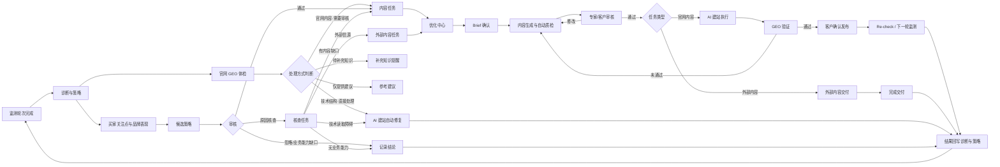
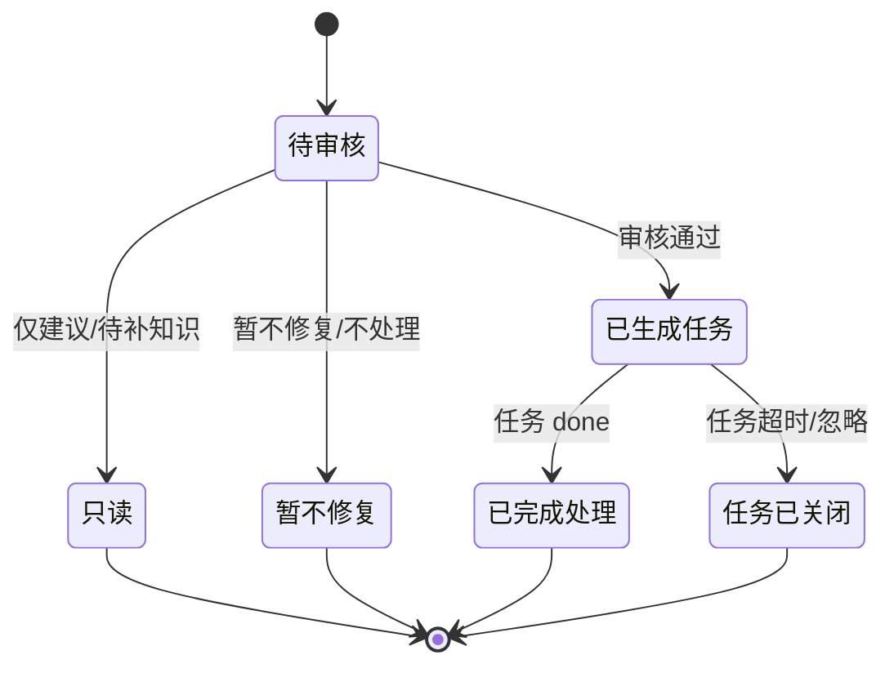
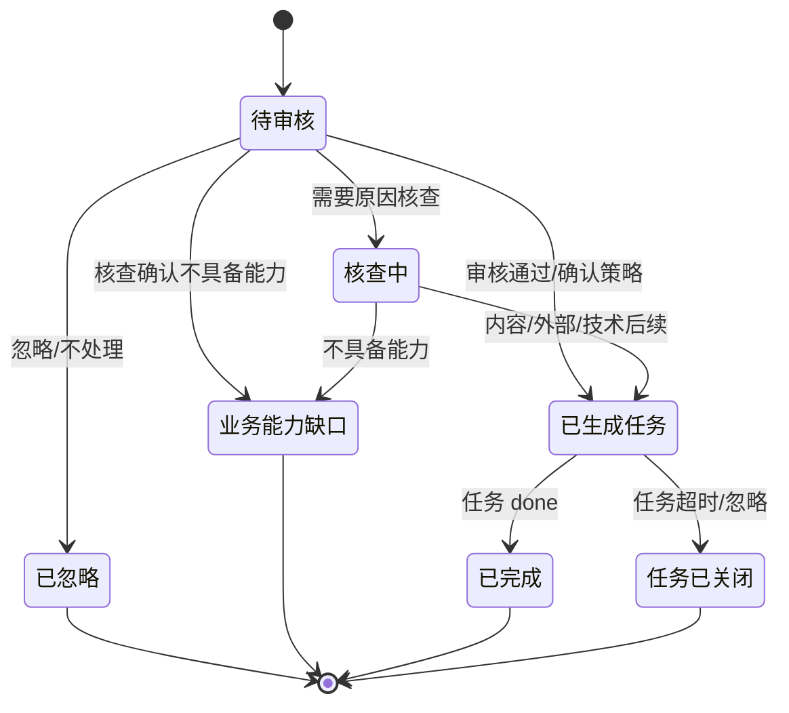

# 诊断与策略 × 优化中心 完整闭环产品开发需求文档（PRD）

> 文档版本：v1.0  
> 编写日期：2026-11-07  
> 基线页面：`http://127.0.0.1:5183/diagnosis?version=managed`  
> 适用产品版本：AI + 专家 + 客户（`managed`）、AI + 客户（`agent`）  
> 文档状态：待产品、设计、前端、后端、测试联合评审  
> 适用范围：诊断与策略页、优化中心、任务工作台，以及两者之间的状态回流和角色协作

---

## 0. 文档使用说明

### 0.1 阅读约定

本文档以当前可运行原型为交互基线，但目标是定义可开发、可联调、可验收的完整产品，而不是复刻原型中的本地演示逻辑。

- **当前原型基线**：可运行原型已经具备、可作为交互参考的能力。
- **目标要求**：本文档要求的产品最终行为；与现有实现冲突时，以本文档评审结论为准。
- **差异清单**：第 1.9 节集中列出当前原型与目标要求的差异，正文不逐条重复标注。
- **P0**：不实现则闭环不成立，阻塞上线。
- **P1**：影响效率或体验，首版应尽量实现。
- **P2**：增强项，可进入后续迭代。

### 0.2 唯一事实源

1. **任务状态是闭环状态的唯一事实源。** 诊断问题（Finding）和候选策略（Strategy）在列表中的处理状态，默认由关联任务实时推导，不允许人工单独维护一套“已完成”状态。
2. **证据不可被结果覆盖。** 任务完成、任务被忽略、任务超时关闭，都不能删除或改写原始诊断依据；只改变处理状态和结果展示。
3. **所有跨页跳转必须可回跳。** 从任务详情能回到来源策略或来源诊断；从诊断/策略能进入关联任务并返回结果。
4. **所有人工决策必须留痕。** 审核、暂不处理、恢复处理、忽略、暂不修复、调整优先级、内容修改、退回修改、发布确认，均记录操作人、时间、动作和说明；其中 `agent` 版的暂不处理/忽略/不处理原因和说明可留空，`managed` 版仍为必填。

---

## 1. 产品概述

### 1.1 背景

GEO Agent 的日常工作不是“生成一篇文章”，而是持续完成一条闭环：

> 监测 AI 如何回答买家问题 → 诊断官网与品牌表现问题 → 判断问题该修、该写、该补资料还是只给建议 → 形成候选策略与任务 → 经过专家/客户审核 → 执行官网或外部内容 → 验证结果 → 下一轮监测复测 → 结果回流诊断与策略。

当前产品已具备诊断、候选策略、任务工作台和官网执行的原型链路，但还存在四类断点：

1. **诊断与执行脱节**：问题和策略看得到，但“谁在什么阶段处理、处理完回到哪里”不够清晰。
2. **处理方式混淆**：技术结构问题、官网内容问题、知识不足、仅建议、外部信源被混在同一套审核动作里。
3. **角色边界不清**：AI、专家、客户在不同阶段谁可编辑、谁可确认、谁可发布，缺少统一规则。
4. **闭环不可验证**：任务完成后，诊断状态、检查项结果、策略状态和下一轮监测之间缺少强关联。

### 1.2 产品目标

1. 让用户在**一个页面内**看清：本轮发现了什么、证据是什么、建议怎么处理、当前处理到哪一步、结果是什么。
2. 让每一个诊断问题或候选策略都能**唯一、可追溯地**进入任务，不重复、不丢失、不悬空。
3. 让官网技术问题、官网内容问题、外部信源、知识补充、参考建议走**各自正确的处理通道**。
4. 让 `managed` 与 `agent` 两种商业版本共享同一套对象模型与状态机，只在**审核责任人、自动执行程度、可见操作**上不同。
5. 让任务完成后，结果能**自动回写**诊断问题、检查项、候选策略和下一轮监测分析。

### 1.3 非目标

本期不包含：

- 监测采样本身的采集器、AI 平台接入和采样调度实现。
- 新人引导、市场配置、报告中心、运营复盘页的完整改造；仅保留必要的跳转和状态衔接。
- AI 写作模型、AI 建站执行器、外部媒体发布渠道的内部实现。
- 计费、套餐权益、组织权限管理的完整后台。
- 外部平台（LinkedIn、YouTube、行业媒体等）的自动发布与 URL 追踪。
- 官网结构调整类候选策略。候选策略只处理内容、实体与信任、外部信源；官网技术结构问题必须走技术直接处理或仅建议，不得进入候选策略审核。

### 1.4 成功指标

| 指标           | 定义                                | 目标           |
| ------------ | --------------------------------- | ------------ |
| 诊断处理率        | 本轮可处理 Finding 中，已审核/暂不修复/已生成任务的比例 | ≥ 90%        |
| 策略采纳率        | 候选策略中审核通过并生成任务的比例                 | 基线建立后逐轮提升    |
| 任务闭环率        | 已创建任务中，最终 `done` 的比例              | ≥ 85%        |
| 平均闭环时长       | 任务创建到 `done` 的中位时长                | 按任务类型分档，持续下降 |
| 返工率          | 客户退回修改或官网验证失败的任务占比                | ≤ 20%        |
| 重复任务率        | 同一来源/同一策略生成多个有效任务的比例              | 0            |
| 来源可追溯率       | 任务可回跳来源诊断或策略的比例                   | 100%         |
| 状态一致率        | 诊断、策略、任务三处状态一致的比例                 | 100%         |
| Re-check 改善率 | 完成后下一轮相关 Gap 缩小或消失的比例             | 作为核心效果指标     |
| 待办老化         | 待我处理任务超过 SLA 未处理的数量               | 持续下降         |

### 1.5 范围

**纳入：**

- 诊断与策略页的三块内容：官网 GEO 体检、买家关注点与品牌表现、品牌表现优化策略。
- 优化中心的待办聚合、任务列表、筛选与分页。
- 任务工作台：Brief、内容生成与质检、内容审核、官网执行与验证、外部内容交付、原因核查、发布确认、Re-check、记录与版本。
- 两种产品版本下的角色、权限、状态、按钮、校验、反馈和跨页回流。
- 支撑以上流程的数据模型、接口需求、埋点、异常处理、验收标准。

**不纳入：**

- 监测数据本身的采集与可信度计算实现。
- 官网 GEO 体检规则的判定算法；本期只消费检查结果。
- AI 建站和外部渠道的真实执行接口；本期定义契约和状态回传要求。
- 报告中心与运营复盘页的页面改造。

### 1.6 用户角色

| 角色         | 说明         | 主要职责                                                  |
| ---------- | ---------- | ----------------------------------------------------- |
| Agent      | GEO 智能体    | 生成诊断、候选策略、Brief、内容草稿、自动质检；推进自动步骤；提交官网执行包；接收回传结果       |
| 专家（ops）    | GEO 专业运营人员 | 专业审核、纠偏、优先级调整、Brief 确认、官网执行提交、异常处理；仅 `managed` 版本存在   |
| 客户（client） | 品牌方业务负责人   | 确认业务事实、执行范围、内容终稿、发布上线；`managed` 版填写暂不处理/忽略原因，`agent` 版可选；`agent` 版本中承担全部人工审核 |
| AI 建站      | 官网执行系统     | 接收执行包，完成页面/结构化数据修改，返回预览、Diff、验证结果                     |
| 监测 Agent   | 监测与复测系统    | 下一轮监测、Re-check、把结果回写诊断与策略                             |
| 系统         | 平台         | 定时推进、超时关闭、状态计算、通知与审计                                  |

### 1.7 两种产品版本

| 维度             | AI + 专家 + 客户（`managed`）            | AI + 客户（`agent`）                  |
| -------------- | ---------------------------------- | --------------------------------- |
| 人工角色           | 专家 + 客户                            | 仅客户                               |
| 诊断 Finding 审核人 | 专家                                 | 客户                                |
| 候选策略审核人        | 专家                                 | 客户                                |
| Brief 确认人      | 专家                                 | 客户                                |
| 内容审核顺序（官网）     | 专家专业审核 → 客户终审                      | 客户审核/改写                           |
| 内容审核顺序（外部）     | 客户确认文案 → 专家专业审核 → 客户终审             | 客户审核/改写                           |
| 官网执行提交人        | 专家                                 | 客户确认后由 Agent 自动提交                 |
| 发布确认人          | 客户                                 | 客户                                |
| 客户能否使用 AI 写作   | 专家审核阶段不可用；客户文案确认/终审阶段可用            | 可用                                |
| 客户退回修改次数       | 官网内容最多 3 次；发布预览最多 1 次              | 无专家可退回，客户直接编辑或确认                  |
| 专家角色切换         | 顶部“本地角色”仅用于原型演示，生产环境由登录身份决定        | 不显示                               |
| 版本切换           | 顶部“产品版本”下拉；查询参数 `?version=managed` | 顶部“产品版本”下拉；查询参数 `?version=client` |

**版本切换规则：**

1. 切换版本时，关闭当前抽屉，保存当前版本快照，再加载目标版本快照。
2. 两个版本的数据相互隔离，不得把 `managed` 的任务状态带入 `agent`。
3. 切换后给出 Toast：`已切换到 AI + 专家 + 客户版` 或 `已切换到 AI + 客户版`。
4. 通过 URL 直接进入时，`version` 参数优先于本地记忆；无参数时使用本地记忆，默认 `managed`。
5. `agent` 模式下，任何人访问都按客户角色渲染；后端仍必须做服务端权限校验，不能只依赖前端隐藏按钮。

### 1.8 核心术语

| 术语              | 定义                                                            |
| --------------- | ------------------------------------------------------------- |
| 监测轮次            | 一次完整的 AI 回答采样与官网体检周期；包含时间、市场、语言、人设、意图、关键词、样本数、平台、可信度          |
| Finding / 诊断问题  | 官网 GEO 体检或监测分析产生的一条待判断事项，包含证据、优先级、处理方式和处理状态                   |
| 检查项             | 官网 GEO 体检的 7 个固定维度：抓取渲染、爬取障碍、索引与 AI 指引、结构化数据、品牌实体、信任信号、跨平台一致性 |
| 人设 / Persona    | 目标买家角色，例如复材技术负责人、航空采购、日本商社、车间主管、质量管理负责人                       |
| 关注点 / Topic     | 买家在决策中关注的主题，例如切割精度、交期与产能、本地服务与培训、认证与合规                        |
| 覆盖差距 / Gap      | 同一人设、同一主题、同一平台下，竞品正向覆盖率减去我方正向覆盖率；只有大于 0 且有关联策略时才作为可行动 Gap 展示  |
| 候选策略 / Strategy | Agent 基于 Gap、回答证据或审计发现提出的优化建议，分为官网内容、外部信源两类                   |
| 任务 / Task       | 可执行的优化单元；一个任务可以关联一个或多个策略，也可以直接来源于一条官网体检 Finding               |
| Brief           | 任务执行基线，包含任务目标、目标人设、决策因子、执行对象、验收条件、执行方法、知识资料、补充说明、联网补充设置       |
| 执行包             | 提交给 AI 建站的官网变更说明，包含目标站点、目标页面、变更类型、执行内容、事实边界、验收条件              |
| Re-check        | 发布或交付后，由下一轮监测验证效果并回写诊断/策略的步骤                                  |
| 业务能力缺口          | 经核查确认客户实际不具备某业务能力；只记录，不生成宣称该能力的内容                             |
| 原因核查            | 在生成内容前，对“为什么 AI 没有推荐我们”进行证据核查；结论可能是补内容、改内容、技术修复、外部信源或业务能力缺口   |

### 1.9 当前原型与目标差异

| 序号 | 当前原型                                      | 目标要求                                                              | 优先级 |
| -- | ----------------------------------------- | ----------------------------------------------------------------- | --- |
| 1  | 诊断、策略、任务、审核记录由本地 mock 与 `localStorage` 驱动 | 全部改为真实 API + 服务端持久化；本地只保留草稿缓存                                     | P0  |
| 2  | 数据处理状态用 6 秒/阶段的本地计时器模拟                    | 由后端任务状态驱动；前端轮询或订阅；失败可重试                                           | P0  |
| 3  | 官网任务客户确认发布后直接进入 `done`                    | 进入 `recheck`，由监测 Agent 完成复测后再 `done`；若产品确认采用“发布即完成”，需在评审中明确并同步改文案 | P0  |
| 4  | `managed` 的检查项通过/异常部分使用静态 `passed` 字段     | 两种版本都根据 Finding 与任务结果实时计算检查项状态                                    | P0  |
| 5  | 顶部“产品版本”“本地角色”是原型调试入口                     | 生产环境按登录身份和套餐渲染；调试入口仅开发环境可见                                        | P0  |
| 6  | 已忽略任务的状态文案、筛选入口不完全统一                      | 统一为“已忽略”，使用独立筛选；与“已暂不处理”区分，并保留决策原因                                 | P1  |
| 7  | 诊断批量选择的事件已存在，但当前页面未展示批量操作入口               | 明确是否恢复批量审核；若恢复，按 4.4.7 的规则实现                                      | P1  |
| 8  | 策略详情未完整展示证据快照                             | 展示策略依据、各平台覆盖差距和证据快照；无原文时明确提示“未接入回答原文”                             | P1  |
| 9  | 直接处理由本地定时器模拟成功                            | 接入 AI 建站真实执行状态，支持失败、重试、超时和结果回传                                    | P0  |
| 10 | 外部内容在 `managed` 下为客户确认 → 专家审核 → 客户终审      | 保留或简化需产品确认；无论顺序如何，外部声明必须由客户确认                                     | P1  |
| 11 | 任务列表默认按数据顺序展示                             | 待我处理优先、P0/P1 优先、最近更新优先；已完成沉底                                      | P1  |
| 12 | 任务编号、显示编码、内部 ID 混用                        | 列表显示稳定的人类可读编码；内部 ID 不随展示变化                                        | P1  |

---

## 2. 完整闭环总览

### 2.1 闭环主链路

### 2.2 闭环阶段与门禁

| 阶段       | 输入                    | 主要动作               | 输出                | 门禁                               |
| -------- | --------------------- | ------------------ | ----------------- | -------------------------------- |
| 1. 监测完成  | 采样数据、官网抓取结果           | 生成轮次、指标、证据         | 当前轮次诊断数据          | 可信度达到趋势级/决策级，或用户主动查看             |
| 2. 诊断    | 检查项结果、人设 Gap、回答证据     | 识别问题、归类处理方式        | Finding 列表、Gap 列表 | 每条 Finding 必须有证据与处理方式            |
| 3. 分流    | Finding               | 直接处理/需要审核/补充知识/仅建议 | 自动任务、待审核项、只读项     | 技术结构问题不得进入候选策略                   |
| 4. 策略    | Gap、审计发现、核查结论         | 生成候选策略、审核、忽略       | 已通过策略/业务能力缺口      | 策略必须有关联证据或核查记录                   |
| 5. 编排    | 已通过策略或审核通过的内容 Finding | 去重、合并、创建任务         | 任务草稿              | 同一来源不得重复创建有效任务                   |
| 6. Brief | 任务草稿                  | 补知识、写说明、确认目标与范围    | 已确认 Brief         | 至少 1 个执行方法；目标/对象/验收完整；至少 1 个内容依据 |
| 7. 生成与质检 | Brief、知识、方法           | AI 生成、自动检查         | 待审核产物             | 产物非空，外部声明标记完整                    |
| 8. 审核    | 产物                    | 专家审核、客户审核、退回修改     | 已确认最终稿            | 当前审核人通过；外部声明已确认；修改次数未超限          |
| 9. 执行    | 执行包                   | 官网 AI 建站 / 外部交付    | 预览、Diff、验证结果      | 官网执行必须通过 GEO 验证                  |
| 10. 发布   | 验证结果、预览               | 客户确认发布             | 已发布/已交付           | 仅客户可确认；发布预览修改不超过 1 次             |
| 11. 复测   | 发布结果、下一轮监测            | Re-check、结果回写      | 任务完成、诊断/策略更新      | 复测完成或明确标记未执行                     |
| 12. 学习   | 全链路记录                 | 运营复盘、Agent 优化      | 规则/策略改进           | 不阻塞单任务闭环                         |
|          |                       |                    |                   |                                  |
|          |                       |                    |                   |                                  |

### 2.3 五类处理方式

| 处理方式            | 技术枚举值                       | 适用场景                                | 是否人工审核 | 是否生成任务 | 任务类型         | 状态流转              |
| --------------- | --------------------------- | ----------------------------------- | ------ | ------ | ------------ | ----------------- |
| 官网技术与结构 · 直接处理  | `website-tech-direct`       | 结构化数据缺失、sameAs 不完整、认证编号未结构化等确定性技术问题 | 否      | 是，自动创建 | `repair`     | 自动执行 → 已完成处理      |
| 官网技术与结构 · 仅提供建议 | `website-tech-advice`       | 可选导航、体验优化，不影响本轮抓取/抽取                | 否      | 否      | —            | 无需处理              |
| 官网内容 · 需要审核     | `website-content-review`    | 内容缺失、事实不一致、表达不清、作者档案、地址口径等          | 是      | 是      | `web` 或按策略类型 | 审核 → Brief → 内容任务 |
| 官网内容 · 仅提供建议    | `website-content-advice`    | 可选表达优化、后续维护建议                       | 否      | 否      | —            | 无需处理              |
| 官网内容 · 待补充知识库   | `website-content-knowledge` | 缺少标准资料，无法判断官网内容是否正确                 | 否      | 否      | —            | 待补充知识库，下一轮重新核对    |

**必须遵守的分流规则：**

1. **技术结构问题不进入候选策略。** 页面结构、抓取、索引、canonical、导航等技术问题，只能走直接处理或仅建议。
2. **内容表达与段落改写属于内容优化。** 进入内容审核/内容任务，不走技术修复。
3. **知识不足不等于内容错误。** 只展示补充要求和补充主题，不生成改写任务，不判定官网错误。
4. **仅建议不进入审核队列。** 不生成任务、不占用待办、不改变检查项通过状态。
5. **业务能力未经核实，不得生成宣传内容。** 在 `agent` 版本中先进入原因核查；核查确认不具备能力时，只记录业务能力缺口。

---

## 3. 全局交互规范

### 3.1 页面框架

| 区域     |   | 说明                                   |
| ------ | - | ------------------------------------ |
| 顶部应用栏  |   | 产品标识、租户、套餐、账户；只读展示，不在本期改造            |
| 左侧导航   |   | 工作台一级/二级导航；诊断与策略、优化中心为当前闭环入口         |
| 工作台工具栏 |   | 页面标签、产品版本切换、原型角色切换（仅开发/演示）、数据状态、市场切换 |
| 主内容区   |   | 单纵向滚动；宽表格局部横向滚动，不允许整页横向滚动            |
| 抽屉     |   | 右侧滑出，用于详情和审核，不打断列表上下文                |
| Toast  |   | 右下角，操作结果反馈；带任务链接时延长展示                |
| 全屏处理态  |   | 数据处理未完成时，替换当前页面内容，显示阶段进度             |
|        |   |                                      |

### 3.2 页面标题与帮助

1. 页面标题左侧为标题文本，右侧为圆形 `?` 信息图标。
2. 点击或键盘聚焦信息图标，打开说明浮层；浮层包含页面用途、处理规则和角色边界。
3. 诊断页标题右侧还会显示：
   - 阶段标签：`当前阶段 · 确认问题与处理方向`
   - 文本按钮：`查看流程 →`
4. 点击“查看流程”打开流程抽屉：
   - 标题：`诊断与策略如何进入执行`
   - 内容：5 步流程 + 角色分工表
   - 底部主按钮：`知道了`，点击关闭。
5. 页面标题下不重复展示大段说明文字，避免与信息浮层冲突。

### 3.3 抽屉（Drawer）

| 属性   | 规则                                                    |
| ---- | ----------------------------------------------------- |
| 方向   | 右侧                                                    |
| 宽度   | 策略详情 `560px`；Finding 详情 `600px`；流程/基线/待办 `400px`      |
| 结构   | 标题区（可含 eyebrow、标题、副标题）、可滚动正文、固定底部操作区                  |
| 标题顺序 | 策略与 Finding 使用“标题优先”，eyebrow 在标题下方；其他抽屉 eyebrow 在标题上方 |
| 关闭方式 | 右上角关闭按钮、`Esc`、点击遮罩                                    |
| 焦点   | 打开后焦点进入标题或首个可操作元素；Tab 在抽屉内循环；关闭后焦点回到触发元素              |
| 滚动   | 只允许抽屉正文滚动；底部操作区固定可见                                   |
| 表单校验 | 校验失败不关闭抽屉，在表单内或 Toast 中提示                             |
| 跳转   | 从抽屉进入任务时先关闭抽屉，再路由跳转，避免抽屉叠抽屉                           |
| 二次确认 | 忽略、暂不修复、发布确认等不可逆动作使用内联二次表单或确认区，不使用浏览器原生 `confirm`     |

### 3.4 Toast 与通知

| 场景           | 文案                                | 时长     | 附加动作          |
| ------------ | --------------------------------- | ------ | ------------- |
| 普通成功         | `专家已审核 2 项，处理结果已更新`               | 2.6 秒  | 无             |
| 策略/问题生成任务    | `S-1 已审核，任务已进入优化中心，等待专家确认 Brief。` | 8 秒    | `查看任务 →`      |
| Agent 模式生成任务 | `问题已确认，已生成任务。下一步请确认任务 Brief。`     | 8 秒    | `去确认 Brief →` |
| 忽略策略         | `managed`：`已记录忽略原因，来源诊断仍保留`；`agent` 留空：`已记录不处理，来源诊断仍保留` | 2.6 秒  | 无             |
| 暂不修复         | `managed`：`本轮事项已终止，已保留原因。`；`agent` 留空：`本轮事项已终止。` | 2.6 秒  | 无             |
| 权限不足         | `当前为客户角色，诊断问题由专家审核`               | 2.6 秒  | 无             |
| 版本切换         | `已切换到 AI + 客户版`                   | 2.6 秒  | 无             |
| 数据处理完成       | `诊断与策略页面已经处理完`                    | 常驻，可关闭 | `点击查看 →`      |
| 本地保存不可用      | `本地保存不可用，当前操作仅保留在本次会话`            | 2.6 秒  | 无             |
| 未保存离开        | `请确认已保存修改内容`                      | 2.6 秒  | 无             |

**规则：**

1. Toast 使用 `role="status"`，不抢焦点。
2. 同一时间只显示一个 Toast；新 Toast 覆盖旧 Toast 并重置计时。
3. 带任务链接的 Toast 必须允许点击链接直接进入任务详情。
4. 错误提示优先使用页面内 `role="alert"`，Toast 只做瞬时补充。

### 3.5 列表、筛选与分页

1. 列表使用紧凑密度，表头固定，正文可滚动。
2. 列宽为最小宽度；窄屏时表格容器横向滚动，不压缩文字到不可读。
3. 所有筛选条件之间为 AND 关系。
4. 任一筛选条件改变后，分页回到第 1 页。
5. 当前筛选条件有独立展示文案，例如：
   - `当前查看：① 抓取渲染`
   - `当前查看：全部问题与建议`
6. 有额外筛选时显示 `取消筛选` 文本按钮，点击后清除检查项筛选，但保留处理方式/状态筛选的当前值。
7. 分页摘要格式：`共 {total} 条 · 第 {page} / {pages} 页`。
8. 每页 5 条，策略、Finding、任务列表一致。
9. 列表加载中显示骨架或加载文案；加载失败显示错误文案和重试；空数据显示空态，不显示空白表格。

### 3.6 加载、空态、错误态

| 状态    | 展示要求                                           |
| ----- | ---------------------------------------------- |
| 加载中   | 显示“正在加载”；表格区域保持高度，避免页面跳动                       |
| 空数据   | 显示标题 + 一行可执行建议；例如“当前筛选下没有问题或建议，可调整检查项或处理方式筛选。” |
| 错误    | 显示“异常数据加载失败”“候选策略加载失败”“任务加载失败”等具体模块错误；提供重试     |
| 数据处理中 | 整页替换为处理进度，不展示旧数据；处理完成后 Toast 提示                |
| 无权限   | 控件禁用，并在 `title` 或说明中写明原因；不要只隐藏按钮导致用户不知道发生了什么   |
| 已完成   | 展示结果与“返回优化中心”；不再提供编辑/审核动作                      |
|       |                                                |
|       |                                                |
|       |                                                |

### 3.7 未保存内容保护

1. 任务详情中，Brief 补充说明、联网补充、正文编辑属于未保存内容。
2. 用户点击“返回优化中心”时，如果存在未保存修改，不直接离开，显示 Toast：`请确认已保存修改内容`。
3. 用户保存后再次返回，允许离开。
4. 浏览器刷新/关闭页面时，使用 `beforeunload` 提示（仅在存在未保存内容时）。
5. 本地草稿按 `版本 + 角色 + 任务 ID` 隔离，避免专家和客户互相覆盖。

### 3.8 权限与禁用态

1. 前端权限只负责“不展示不该展示的操作”，后端必须再次校验。
2. 当前角色不能操作时：
   - 优先隐藏不可用按钮；
   - 若按钮需要保留以说明流程，使用禁用态并给出原因。
3. 禁用按钮必须设置 `disabled` 与 `title`，不能只靠颜色变浅。
4. 角色切换后，列表、待办数量、按钮、可编辑字段立即刷新；已打开的抽屉关闭。
5. `agent` 版本不显示“本地角色”切换。

### 3.9 键盘、无障碍与动效

1. 所有 Tab、卡片筛选、检查项、分页、抽屉关闭按钮必须可通过键盘操作。
2. Tab 使用 `role="tab"` + `aria-selected`；检查项使用 `role="tab"` + `aria-selected`，并同步当前筛选。
3. 表格行本身不可点击；操作通过行内按钮完成，避免“整行点击”和按钮点击冲突。
4. 所有图标按钮必须有 `aria-label`。
5. 图表必须有 `role="img"` 和文本替代说明。
6. 遵循 `prefers-reduced-motion`；减少动效时，滚动定位使用 `auto` 而不是平滑滚动。
7. 焦点可见样式：2px 品牌色外描边，偏移 2–3px。
8. 颜色不是唯一状态表达；异常、待审核、已完成同时有文本和图标。

---

## 4. 诊断与策略页

### 4.1 页面结构

页面从上到下固定为：

1. 页面标题区（标题、帮助、阶段标签、查看流程）
2. 本轮监测摘要卡
3. **1 官网 GEO 体检**
4. **2 买家关注点与品牌表现**
5. **3 品牌表现优化策略**

页面描述文案：

> 需要处理的问题按类型进入修复或策略流程；仅提供建议的条目保留依据与参考建议，无需审核或生成任务。

### 4.2 本轮监测摘要

| 字段        | 示例                   | 规则                        |
| --------- | -------------------- | ------------------------- |
| 监测时间 / 轮次 | `2026-10-02 · 第 5 轮` | 取当前展示轮次；进行中轮次明确标注         |
| 市场 / 语言   | `德国 / 德语`            | 来自市场配置                    |
| 买家人设      | `3 类`                | 当前轮次纳入分析的人设数量             |
| 意图        | `4 类`                | 当前轮次覆盖的购买意图数量             |
| 关键词       | `4 个`                | 当前轮次纳入分析的关键词数量            |
| 采样总数      | `1138`               | 当前轮次计划或已完成采样数，需明确口径       |
| AI 平台     | `3 个`                | 当前轮次实际覆盖平台数               |
| 可信度       | `中 · 趋势级`            | 基于已完成轮次与置信区间；进行中轮次不显示为决策级 |

**交互：**

1. 摘要卡不可点击，不承担导航功能。
2. 标题前使用与“优化中心任务概况”一致的 ✦ 标识。
3. 标题右侧状态标签：进行中为 `进行中`；已完成为 `已完成`；数据延迟为 `数据延迟`。
4. 不在摘要卡右上角放“待处理”入口，避免与优化中心“待我处理”重复。
5. 不提供“暂停监测”等与当前页面无关的全局动作。

### 4.3 官网 GEO 体检

#### 4.3.1 区块头部

- 标题：`1 官网 GEO 体检`
- 标题旁 `?` 提示：`确定性技术问题由 AI 建站直接处理，完成后自动更新结果。`
- 右侧统计标签：
  - `{n} 异常`（红色）
  - `待审核 {n}` 或 `待确认 {n}`（橙色）
  - `待核对 {n}`（中性）
  - `已通过 {n}`（绿色）
  - `无需审核 {n}`（中性）

**统计口径（必须统一）：**

| 标签          | 统计范围                                          |
| ----------- | --------------------------------------------- |
| 异常          | 所有非只读 Finding，包含直接处理与需要审核的内容问题；不包含仅建议、待补充知识   |
| 待审核 / 待确认   | 需要审核且尚未生成有效任务、尚未完成的 Finding                   |
| 待核对         | 待补充知识的 Finding；不进入审核或执行                       |
| 已通过         | 需要审核且已生成任务或已完成的 Finding；“通过”表示已通过人工判断，不等于执行成功 |
| 无需审核        | 直接处理 + 仅建议；直接处理由系统自动推进                        |

> 当前原型中“已通过/无需审核”的部分计算口径不完全一致；实现时以本表为准，并补充单元测试。

#### 4.3.2 七个检查项卡片

固定顺序：

1. ① 抓取渲染
2. ② 爬取障碍
3. ③ 索引与 AI 指引
4. ④ 结构化数据
5. ⑤ 品牌实体
6. ⑥ 信任信号
7. ⑦ 跨平台一致性

每张卡片包含：

- 序号圆标
- 检查项名称
- 状态图标：通过 ✓ / 异常 ⚠ / 待核对 ◐
- 悬停/聚焦说明：状态、检查项名称、结果摘要
- 待核对表示该检查项只剩“待补充知识”，既不判为通过，也不进入审核/执行；卡片使用中性色

**交互：**

1. 点击检查项卡片，按该检查项筛选下方 Finding 表格。
2. 再次点击同一检查项：
   - `agent` 模式：取消筛选，回到全部问题。
   - `managed` 模式：保持当前筛选；用户通过“取消筛选”清除。
3. 筛选后分页回到第 1 页，并显示当前查看项。
4. 卡片 `aria-selected` 与当前筛选同步。
5. 网格响应式：
   - 宽屏 7 列；
   - ≤1280px 或 ≤1020px 时 4 列；
   - ≤760px 时 2 列；
   - 卡片高度一致，名称可换行。
6. 异常卡片使用警示色；当前选中卡片使用浅品牌色背景；两者可叠加。
7. 任一模式下，如果当前检查项没有未解决异常、但存在待补充知识，点击后只显示“待核对”结果，不显示空表格、空态或筛选器。
8. 任一模式下，如果当前检查项已全部通过，点击后只显示“通过”结果，不显示空表格、空态或筛选器。
9. 通过结果的提示：`本轮{检查项}检查通过，未发现需要处理的问题。`
10. 待核对结果的提示：`本轮{检查项}仍有待补充知识，补充后可重新核对。`
11. 检查项结果必须根据 Finding 与任务状态实时计算：

- 有关联未解决异常 → 异常；
- 只有待补知识 → 待核对；
- 无未解决异常 → 通过。

#### 4.3.3 筛选器

处理方式筛选（`aria-label="处理方式筛选"`）：

| 值           | 文案     |
| ----------- | ------ |
| `all`       | 全部处理方式 |
| `repair`    | 直接处理   |
| `review`    | 需要审核   |
| `knowledge` | 待补充知识  |
| `advice`    | 仅提供建议  |
|             |        |

处理状态筛选（`aria-label="处理状态筛选"`）：

| 值           | managed 文案 | agent 文案 |
| ----------- | ---------- | -------- |
| `all`       | 全部状态       | 全部状态     |
| `pending`   | 待审核        | 待确认      |
| `approved`  | 已通过        | 已通过      |
| `no-review` | 无需审核       | 无需审核     |

**组合规则：**

- 处理方式 + 处理状态 + 检查项三者 AND。
- “需要审核”筛选只展示 `website-content-review`。
- “直接处理”筛选只展示 `website-tech-direct`。
- “待补充知识”筛选只展示 `website-content-knowledge`。
- “仅提供建议”筛选展示官网结构和官网内容两类建议。
- 空态文案：`当前筛选下没有问题或建议 / 可调整检查项或处理方式筛选。`

#### 4.3.4 Finding 表格

| 列       | 内容                   | 交互                                               |
| ------- | -------------------- | ------------------------------------------------ |
| 序号      | 人类可读编码，如 `F-1`、`F-9` | 只读；内部 ID 不变                                      |
| 问题 / 建议 | Finding 标题           | 单行省略，悬停显示完整标题                                    |
| 处理方式与类型 | 处理方式徽标               | 例如 `官网技术与结构 · 直接处理`、`官网内容 · 需要审核`、`官网内容 · 仅提供建议` |
| 所属检查项   | 序号 + 检查项名称           | 例如 `④ 结构化数据`                                     |
| 优先级     | `P0`–`P3`            | P0 红色，其他中性                                       |
| 处理状态    | 当前状态                 | 见 4.3.5                                          |
| 操作      | 单一主操作按钮              | 见 4.3.6                                          |

**表格交互：**

1. 行不可点击；点击操作按钮打开详情抽屉。
2. 操作按钮使用 secondary 样式；需要审核的动作使用警示色（橙色）突出。
3. 表格分页 5 条/页。
4. 空态、错误态按 3.6 处理。
5. 表格容器只做横向滚动，不撑破页面。

#### 4.3.5 Finding 状态字典

| 状态文案           | 触发条件             | 颜色/语义      |
| -------------- | ---------------- | ---------- |
| 待专家审核 / 待确认    | 需要审核，尚未创建任务      | 橙色，可操作     |
| 已生成任务 · {任务阶段} | 已创建内容任务或关联策略任务   | 蓝色，查看详情/任务 |
| 已完成处理          | 关联任务已完成，或人工标记已修复 | 绿色         |
| AI建站处理中        | 直接处理任务已创建，尚未完成   | 蓝色，系统处理中   |
| 已完成处理（直接处理）    | 直接处理任务完成         | 绿色         |
| 暂不修复           | 人工选择本轮不处理并填写原因   | 中性         |
| 无需处理           | 仅提供建议            | 中性         |
| 待补充知识库         | 缺少核对依据           | 中性         |
| 任务已关闭          | 关联任务超时/被忽略关闭     | 中性         |

**状态派生优先级：**

1. 只读 Finding（仅建议/待补知识）→ 固定只读状态。
2. 暂不修复 → `暂不修复`。
3. 存在关联任务：
   - 任务 `done` → `已完成处理`；
   - 任务 `completionOutcome = expired-unexecuted` → `任务已关闭`；
   - 任务被忽略 → 展示任务阶段的 `已忽略`；
   - 任务已暂不处理 → 展示原阶段的 `已暂不处理`；
   - 其他 → `已生成任务 · {taskStageLabel}`。
4. 无任务：
   - 直接处理且已完成 → `已完成处理`；
   - 已修复 → `已完成处理`；
   - 需要审核 → 待审核；
   - 其他 → `待处理`（内部状态，界面按角色显示待审核/待确认）。

#### 4.3.6 操作按钮文案矩阵

| 条件       | managed 专家      | managed 客户 | agent 客户             |
| -------- | --------------- | ---------- | -------------------- |
| 只读建议     | `查看建议`          | `查看建议`     | `查看建议`               |
| 待补知识     | `查看补充要求`        | `查看补充要求`   | `查看补充要求`             |
| 直接处理     | `查看详情`          | `查看详情`     | `查看详情`               |
| 需要审核且可审核 | `审核`            | `查看详情`     | `确认处理`               |
| 已生成任务    | `查看详情` 或 `查看任务` | `查看详情`     | `查看详情` / `去确认 Brief` |
| 任务已完成    | `查看结果`          | `查看结果`     | `查看结果`               |
| 暂不修复/已关闭 | `查看详情`          | `查看详情`     | `查看详情`               |

> “可审核”= 当前角色是该版本的审核责任人，且该 Finding 没有已生成的关联任务、不是只读项、不是直接处理项。
>
>

#### 4.3.7 Finding 详情抽屉

|                           |      |                          |
| ------------------------- | ---- | ------------------------ |
| 标题：\`{异常处理                | 参考建议 | 补充知识提醒} · {Finding 标题}\` |
| 宽度：`600px`                |      |                          |
| eyebrow：`异常{n}` / `仅提供建议` |      |                          |

**内容分区：**

1. **问题性质与处理方式**
   - 处理方式徽标
   - 优先级（可审核时显示优先级下拉，否则只读）
   - 问题依据 / 检测依据
   - 参考建议 / 处理范围
2. **按版本展示字段**
   - `managed` 专家/客户：
     - 问题依据
     - 参考建议
     - 关联任务（如有）
     - 所属检查项
     - 当前状态
     - 暂缓原因（如有）
   - `agent` 客户：
     - 问题对象（官网结构 / 官网内容）
     - 检测依据
     - 处理范围
     - 直接处理时：执行对象、拟修改项、验证结果
     - 关联任务（如有）
     - 所属检查项
     - 当前状态
     - 终止原因（如有）
   - 只读项：
     - 问题依据
     - 参考建议 / 补充要求
     - 当前状态

3. **关联任务卡片**
   - 显示 `任务编号 · 任务名称`
   - 显示任务阶段
   - 显示辅助说明：
     - 已关闭未执行：`任务已关闭，未执行优化`
     - 已完成：`执行结果已回流到诊断与策略`
     - 进行中：`任务执行中，状态会持续同步`
   - 按钮：`查看任务` / `查看结果`
4. **底部操作区**
   - `关闭`
   - 可审核且非直接处理：
     - `暂不修复`（managed）/ `不处理`（agent）
     - `审核通过并生成任务`（managed）/ `确认处理并生成任务`（agent）
   - 暂不修复表单展开时：
     - `取消`
     - `确认暂不修复` / `确认不处理`
   - 不可审核但已有任务/策略：
     - `进入任务` / `去确认 Brief` / `进入策略`

#### 4.3.8 暂不修复 / 不处理

**交互步骤：**

1. 点击 `暂不修复` / `不处理`，详情区展开内联表单。
2. 表单字段：
   - `managed`：原因下拉（必填）、说明文本域（必填）
   - `agent`：原因下拉（可选）、说明文本域（可选），均留空也可确认
3. 原因选项：
   - Agent 判断错误 / 策略不适用
   - 事实 / 证据不足
   - 重复策略 / 已有其他方案
   - 时机不合适
   - 执行成本过高
   - 不符合当前业务目标
   - 其他
4. `managed` 未选择原因时点击确认 → Toast：`请选择暂不修复原因`。
5. `managed` 未填写说明时点击确认 → Toast：`请填写暂不修复说明`。
6. 确认后：
   - Finding 状态改为 `暂不修复`；
   - 有填写内容时记录 `decisionReason = {原因}：{说明}`；`agent` 留空时仅记录操作人、时间和动作；
   - 记录操作人、时间；
   - 关闭抽屉；
   - Toast：`managed` 为 `本轮事项已终止，已保留原因。`；`agent` 未填写时为 `本轮事项已终止。`
7. 已被终止的 Finding 不再出现在待办中，但保留在列表与检查项统计中。
8. 不允许对直接处理、仅建议、待补知识、已生成任务、已完成的 Finding 执行该动作。

#### 4.3.9 审核并生成任务

**managed（专家）：**

1. 点击 `审核通过并生成任务`。
2. 系统校验当前角色为专家、Finding 可审核。
3. 若 Finding 为官网内容：
   - 创建任务：`type=web`、`origin=geo-audit`、`source=finding.id`、`progress=brief`；
   - 写入审计内容快照：问题与依据、原内容、修改范围；
   - 若该 Finding 已映射到候选策略（如专家档案 GS14），不重复创建，改为关联已有策略任务；
   - Finding 状态改为 `已生成策略/已生成任务`；
   - 记录审核日志；
   - 关闭抽屉；
   - Toast：`官网内容问题已审核，任务已进入优化中心，等待专家确认 Brief。` + `查看任务 →`。
4. 若 Finding 为技术直接处理：
   - 创建 `repair` 任务；
   - 自动进入执行，无需人工审核；
   - 页面上不应出现“审核”按钮。
5. 若 Finding 为“信息口径”类内容问题（如 F9 地址不一致）：
   - 创建 `web` 任务，不走技术修复；
   - Brief 中展示问题与依据、修改范围；
   - 外部平台信息另行核查，不自动修改。

**agent（客户）：**

1. 点击 `确认处理并生成任务`。
2. 校验角色为客户、Finding 可审核。
3. 内容类 Finding 创建任务，状态改为已生成；
4. 直接处理 Finding 由系统自动创建任务；
5. Toast：`问题已确认，已生成任务。下一步请确认任务 Brief。` + `去确认 Brief →`。

#### 4.3.10 批量审核（P1，当前原型入口待恢复）

如果产品决定保留批量审核：

1. Finding 表格增加选择列；只允许选择“可审核”的 Finding。
2. 表头全选只选择当前筛选结果中的可审核项。
3. 选中后显示：`已选 {n}`、`清除选择`、`审核通过并生成任务`。
4. 批量审核逐条执行与单条相同的分流和幂等规则。
5. 部分成功时：
   - 成功项正常生成任务；
   - 失败项保持原状态；
   - Toast：`已审核 {success} 项，{failed} 项失败`；
   - 失败原因可在详情中查看。
6. 批量操作不改变用户当前筛选与分页，除非总页数变化导致当前页越界。

### 4.4 买家关注点与品牌表现

#### 4.4.1 区块结构

- 标题：`2 买家关注点与品牌表现`
- 副标题：`基于买家人设下的 AI 回答，识别关注话题、品牌覆盖差距与优化机会`
- 内容：
  1. 人设 Tab
  2. 左侧：关注点与品牌覆盖雷达图
  3. 右侧：关注点与品牌覆盖差距列表 + 平台筛选

#### 4.4.2 人设 Tab

1. 每个 Tab 显示：
   - 人设名称
   - `{n} Gap`
2. 点击切换人设：
   - 加载该人设的雷达图与 Gap 列表；
   - 清除“聚焦主题”；
   - 策略分页回到第 1 页；
   - 不改变策略分层筛选。
3. 当前 Tab 使用品牌色背景与 `aria-selected="true"`。
4. 人设数量多时横向滚动或换行，不压缩文字。
5. 人设 Gap 数量口径：该人设下可行动 Gap 数（正 Gap 且有关联策略），与右侧列表一致。

#### 4.4.3 雷达图

- 标题：`{人设} · 关注点与品牌覆盖`
- 图例：
  - 买家关注度（橙色）
  - 我方覆盖（品牌色）
  - 竞品覆盖（绿色）
- 维度：该人设的决策因子，排除“其他”占位项。
- 每个维度最大 100。
- 数据为空时显示 `暂无数据`，不画 0 值假图。
- 图表下方提供文本替代说明：`雷达图：买家关注度、我方与竞品正向覆盖率，均以当前有效回答数为分母`。

**指标口径：**

1. 分母 = 当前人设 + 当前主题 + 当前平台下的**去重有效回答数**。
2. 同一回答同时提及我方和竞品时，双方各自计数，不互斥。
3. 关注度 = 提及该主题的回答数 ÷ 有效回答数。
4. 我方覆盖率 = 我方正向提及回答数 ÷ 有效回答数。
5. 竞品覆盖率 = 竞品正向提及回答数 ÷ 有效回答数。
6. Gap = 竞品覆盖率 − 我方覆盖率，保留 2 位小数；允许负值，但右侧可行动列表只展示正值。
7. 没有有效回答时，指标返回 `null`，界面显示 `暂无数据`，不得合成 0。

#### 4.4.4 关注点与品牌覆盖差距列表

- 标题：`关注点与品牌覆盖差距`
- 说明：`关注度、我方与竞品覆盖率都以当前人设和平台下该因子的有效回答数为分母；仅展示竞品领先且有关联策略的因子。`
- 平台筛选（`aria-label="按 AI 平台筛选主题差距"`）：
  - 全部平台
  - ChatGPT
  - Perplexity
  - Google AI

每行展示：

1. 序号 + 主题名称 + `↗`
2. `Gap {n}`
3. `关注度 {n}%（{hits}/{denominator}） · 我方 {n}% · 竞品 {n}%`
4. `点击筛选下方策略`
5. `关联策略 {n}`

**交互：**

1. 点击一行：
   - 将该主题设为“聚焦主题”；
   - 如果当前人设不是该行所属人设，先切换人设；
   - 如果当前策略分层不是“全部”，自动切回“全部”；
   - 滚动到第 3 区块标题；
   - 策略列表只保留与该人设 + 主题有关联的策略；
   - 不打开任何“回答详情”抽屉。
2. 聚焦后，策略区显示 `当前人设：{name}` 和 `聚焦：{topic}`，并提供 `查看全部策略` 文本按钮。
3. 再次点击同一行、清除聚焦、切换人设、切换平台，都会取消聚焦。
4. 行使用 `aria-pressed` 表示是否聚焦。
5. 切换平台：
   - 重新计算雷达图与差距列表；
   - 清除聚焦；
   - 策略分页回到第 1 页。
6. 空态：`当前平台没有需要策略分析的覆盖差距。`

#### 4.4.5 策略表中的 Gap 链接

1. 策略行“关联关注点与差距”列展示多个 Gap 链接：
   - `{人设} · {主题} · Gap {n} ↗`
2. 悬停显示该主题在各平台的差距：
   - 标题：`各平台覆盖差距`
   - 每行：平台、Gap、`我方 x% · Flow y% · n 条`
   - 无数据：`暂无数据` / `无有效回答`
3. 点击 Gap 链接：
   - 切换到对应人设；
   - 聚焦该主题；
   - 过滤下方策略；
   - 链接 `aria-pressed` 为 true 并高亮。
4. 对于没有正向 Gap 的审计来源策略（如 GS14）：
   - 不展示 Gap 链接；
     |   |   |
     | - | - |
   - 展示 `策略依据：{source} · {核查已完成 | 待核查正向覆盖证据}`。

### 4.5 品牌表现优化策略

#### 4.5.1 区块结构

- 标题：`3 品牌表现优化策略`
- 帮助提示：
  - `managed`：`候选策略依据人设认知 GAP、回答证据与原因核查结果提出。专家审核通过后生成任务；客户可查看处理结果。`
  - `agent`：`候选策略依据人设认知 GAP、回答证据与原因核查结果提出。客户审核通过后生成任务；不处理时可不填写原因。`
- 顶部上下文行：
  - `当前人设：{name}`
  - 聚焦标签：`聚焦：{topic}`（如有）
  - `查看全部策略`（聚焦时显示）
- 分层 Tab：
  - `全部 · {n}`
  - `官网内容 · {n}`（内部层值：内容）
  - `外部信源 · {n}`

**约束：**

- 候选策略只包含官网内容与外部信源。
- 实体与信任类内容（作者档案、认证事实、sameAs 相关的内容表达）归入官网内容。
- 官网结构调整、抓取、索引、导航等技术问题不得出现在候选策略中。

#### 4.5.2 策略表格

| 列        | 内容                 | 交互            |
| -------- | ------------------ | ------------- |
| 序号（问题编码） | 人类可读策略编码，如 `S-1`   | 只读            |
| 优先级      | P0–P3              | P0 红色         |
| 策略类型     | 官网内容 / 外部信源        | 只读            |
| 描述       | 策略标题               | 单行省略，悬停显示完整内容 |
| 关联关注点与差距 | Gap 链接或策略依据        | 见 4.4.5       |
| 当前状态     | 待审核/已生成任务/已完成/已忽略等 | 见 4.5.3       |
| 操作       | 审核/查看详情/查看任务/查看结果  | 见 4.5.4       |

**排序：**

1. 默认按优先级 P0 → P3。
2. 同优先级按数据顺序。
3. 已完成/已忽略沉底或保持原顺序；不得因为任务完成而让策略“消失”。

**分页：**

- 5 条/页。
- 分层、聚焦、人设、平台变化后回到第 1 页。
- 当前页越界时自动回退到最后一页。

#### 4.5.3 策略状态字典

| 状态           | 条件              | managed | agent |
| ------------ | --------------- | ------- | ----- |
| 待专家审核        | 无任务、无结论、当前角色可审核 | 橙色      | —     |
| 待确认          | 无任务、无结论、当前角色可审核 | —       | 橙色    |
| 已通过          | 已确认但尚未生成任务（瞬时态） | 绿色      | 绿色    |
| 已生成任务 · {阶段} | 存在关联任务且未完成      | 蓝色      | 蓝色    |
| 已完成          | 关联任务 `done`     | 绿色      | 绿色    |
| 已忽略          | 人工忽略            | 中性      | 中性    |
| 本轮已终止        | `agent` 下人工忽略   | —       | 中性    |
| 业务能力缺口       | 核查确认不具备能力       | —       | 中性/警示 |
| 任务已关闭        | 关联任务超时关闭        | 中性      | 中性    |

**状态由任务推导，不单独存储“已完成”。**

#### 4.5.4 策略操作按钮

| 条件                       | 按钮              |
| ------------------------ | --------------- |
| 当前角色可审核，且无任务、未忽略、无业务缺口   | `审核` / `确认策略`   |
| 当前角色可审核，但为 `agent` 且需要核查 | `确认策略`（内部走核查分支） |
| 已有任务且未完成                 | `查看任务`          |
| 已有任务且完成                  | `查看结果`          |
| 已完成/已忽略/业务缺口/任务关闭        | `查看详情`          |
| 非当前审核角色                  | `查看详情`          |

**点击行为：**

- `审核` / `确认策略`：打开策略详情抽屉。
- `查看任务` / `查看结果`：直接进入任务详情。
- `查看详情`：打开策略详情抽屉，只读展示结论、证据和关联任务。

#### 4.5.5 策略详情抽屉

宽度：`560px`  
标题优先：策略标题在上，eyebrow `认知缺口策略 {n}` 在下。

**内容分区：**

1. **认知缺口策略**
   - 状态标签
   - 优先级（可审核时可编辑）
   - 策略类型（官网内容 / 外部信源）
   - 目标人设
   - 决策因子
2. **Agent 建议方法**
   - 推荐说明，例如：
     - `建议采用对比表、FAQ、统计数据注入等方式，完成本次官网内容优化。`
     - `建议采用第三方内容建设、专家引语等方式，完成本次外部信源建设。`
   - `agent` 下若需要核查：
     - `先核查原始回答、真实业务能力和已有资料，形成可追溯的原因结论；本任务不直接生成宣传内容。`
   - `agent` 下若为业务能力缺口/技术问题：
     - 展示核查结论，不展示“生成内容”建议。
3. **关联任务**
   - 任务编号、名称、阶段
   - 结果说明
   - 按钮：`查看任务` / `查看结果`
4. **策略依据**
   - 聚合 Gap：
     - `全部平台汇总 Gap +{n} 个百分点`
     - `我方 x% · Flow y% · 有效回答 n 条`
   - 分平台：
     - `ChatGPT / Perplexity / Google AI`
     - `Gap ±n 个百分点`
     - `我方 x% · Flow y% · 有效回答 n 条`
     - 无数据时 `暂无数据`
   - 证据快照：
     - 展示策略的 `evidence`，例如 `页面被 Perplexity 引为来源，但回答只推荐 Flow`
     - 若未接入回答原文，明确显示：`未接入该策略对应的回答原文`
   - 无正向 Gap：
     - `尚未匹配到可核对的正向覆盖差距，请先核查关联主题。`
5. **忽略表单（展开后）**
   - 原因下拉（必填）：
     - 优先级判断错误
     - 标题生成不准确
   - 说明文本域（必填）
   - 占位：`补充说明`
6. **底部操作区**
   - `关闭`
   - 可审核：
     - `忽略` / `不处理`
     - `审核通过并生成任务` / `确认策略并生成任务`
   - 忽略表单展开时：
     - `取消`
     - `确认忽略` / `确认不处理`
   - 已有任务：
     - `查看关联任务`

#### 4.5.6 策略审核

**managed：**

1. 只有专家可审核；客户打开抽屉只读。
2. 点击 `审核通过并生成任务`。
3. 系统校验：
   - 策略未确认、未忽略、无业务能力缺口；
   - 无有效关联任务；
   - 当前角色为专家。
4. 按策略类型编排任务：
   - `内容` → `type=web`，目标为官网内容；
   - `外部信源` → `type=external`，目标为外部内容交付。
5. 去重/合并规则见 7.5。
6. 策略确认，生成任务 `progress=brief`。
7. 记录审核日志：`专家审核通过，Agent 已自动编排关联 Task 草稿。`
8. 关闭抽屉，Toast：`{策略编码} 已审核，任务已进入优化中心，等待专家确认 Brief。` + `查看任务 →`。

**agent：**

1. 只有客户可审核。
2. 点击 `确认策略并生成任务` 后，先执行原因核查分流：

| 核查结论                       | 系统行为                                  | 是否生成内容任务 | 提示                            |
| -------------------------- | ------------------------------------- | -------- | ----------------------------- |
| 需要核查（`verify`）             | 创建 `executionKind=verification` 的核查任务 | 否        | `问题已确认，已生成任务。下一步请确认任务 Brief。` |
| 实际不具备能力（`business-gap`）    | 记录业务能力缺口，不生成任务                        | 否        | `已记录业务能力缺口，不生成内容任务。`          |
| 内容完整但读取障碍（`technical`）     | 创建/关联官网技术直接处理任务                       | 否        | `已关联技术直接处理流程，可在官网体检中查看执行结果。`  |
| 需要第三方来源（`external`）        | 创建外部内容任务                              | 是        | `已生成外部内容任务。下一步请确认任务 Brief。`   |
| 有能力但官网未介绍（`add-content`）   | 创建官网内容任务                              | 是        | `已生成任务。下一步请确认任务 Brief。`       |
| 已有介绍但表达不明确（`edit-content`） | 创建官网内容任务                              | 是        | `已生成任务。下一步请确认任务 Brief。`       |

1. 若该策略已有任务，则不再创建，直接打开关联任务。
2. 若策略已被忽略或记录为业务能力缺口，只提示并打开详情。
3. 核查任务的 Brief 确认后不自动生成文章、不自动提交官网。

#### 4.5.7 忽略策略

1. 点击 `忽略` / `不处理` 展开内联表单。
2. `managed` 必须选择原因并填写说明；`agent` 可不填写。
3. `managed` 校验失败：
   - 未选原因：`请选择忽略原因`
   - 未填说明：`请填写忽略原因`
4. 确认后：
   - 策略标记为已忽略；
   - 有填写内容时记录 `reviewNote = {原因}：{说明}`；`agent` 留空时不写入 `reviewNote`；
   - 记录审核日志：有填写时为 `忽略候选策略 · {原因}：{说明}`，`agent` 留空时为 `已记录不处理候选策略`；
   - 关闭抽屉；
   - Toast：`managed` 为 `已记录忽略原因，来源诊断仍保留`；`agent` 未填写时为 `已记录不处理，来源诊断仍保留`。
5. 忽略不删除来源 Finding，不改变检查项实际结果，只是不再进入执行。
6. 已忽略策略仍可在列表中通过状态查看。

#### 4.5.8 优先级调整

1. 仅可审核角色可在策略详情或 Finding 详情中调整优先级。
2. 下拉选项：P0、P1、P2、P3。
3. 变更后立即保存并记录：
   - `调整优先级：{旧} → {新}`
   - 操作人、时间。
4. 优先级变更不触发任务重排，但任务列表排序应使用最新策略优先级。
5. 非可审核角色只读展示优先级。

#### 4.5.9 策略原因核查任务

`agent` 版本中，无法确认业务能力或内容原因时，先创建核查任务。

**任务字段：**

- 名称：`核查：{策略标题}`
- `type=web`
- `executionKind=verification`
- `destination=核查记录`
- `progress=brief`
- `strategy={策略 ID}`
- `relatedStrategies=[策略 ID]`
- 方法：`核查原始回答、真实业务能力与已有资料`

**任务详情交互：**

1. Brief 阶段：确认核查目标、对象和方法。
2. 确认后进入 `human`（待客户核查）。
3. 展示“原因核查”面板：
   - 核查结果下拉：
     - 有能力，官网未介绍
     - 已有介绍，表达不明确
     - 内容完整，存在读取障碍
     - 需要补充第三方来源
     - 实际不具备该能力
   - 核查记录文本域
   - `保存核查草稿`
   - `保存核查结论并完成`
4. 完成条件：必须选择结论且填写核查记录。
5. 完成后：
   - 更新关联策略的 `gapFacts`；
   - 业务能力缺口：记录到策略，不生成内容；
   - 技术问题：创建直接修复任务并关联策略；
   - 内容/外部：创建后续候选策略，进入待审核；
   - 任务 `done`；
   - 提供 `查看后续处理`。
6. 核查任务不生成文章，不提交官网。

### 4.6 状态回流规则

1. **Finding → 任务**：审核通过后立即显示 `已生成任务 · Brief 待确认`。
2. **任务阶段变化 → Finding/策略状态**：任务进入审核、官网执行、Re-check 时，来源对象同步展示当前阶段。
3. **任务完成 → 来源对象已完成**：任务 `done` 后，Finding 显示 `已完成处理`，策略显示 `已完成`。
4. **任务关闭 → 来源对象任务已关闭**：超时未提交或被忽略时，来源对象显示 `任务已关闭`，并保留原因。
5. **任务忽略 → 来源诊断仍保留**：检查项不会因为任务忽略而变成通过；未解决异常仍影响检查结果。
6. **下一轮监测 → 重新计算 Gap**：新轮次可以关闭旧 Gap、产生新 Gap；历史策略和任务保留。
7. **Re-check 结果 → 效果回流**：完成后记录相关主题/检查项的改善或未改善，供运营复盘和 Agent 学习。

---

## 5. 优化中心

### 5.1 页面结构

1. 页面标题：`优化中心 · 任务工作台`
2. 页面说明浮层：
   - `官网体检确认后生成独立任务；候选策略可按执行目标合并为一项任务。任务先确认 Brief，再进入内容执行与审核。`
3. 任务概况与待我处理
4. 任务列表
5. 任务筛选
6. 分页

### 5.2 任务概况

| 字段        | 规则                   |
| --------- | -------------------- |
| 监测时间 / 轮次 | 与诊断页一致，显示当前轮次        |
| 全部任务      | 当前版本全部任务数            |
| 官网内容      | `type=web` 的任务数      |
| 外部内容      | `type=external` 的任务数 |
| 官网结构与技术   | `type=repair` 的任务数   |

**交互：**

1. 统计卡不可点击，仅展示。
2. 数字使用大号强调，后接 `项`。
3. 任务数随筛选变化？不。概况统计始终为全量任务，不受列表筛选影响；列表数量在任务列表标题处单独展示。
4. 当前原型不再提供“优化窗口”选择器；所有窗口任务统一展示，按任务状态和更新时间管理。

### 5.3 待我处理

标题：`待我处理 {总待办数}`

待办卡片固定顺序：

1. 确认 Brief
2. 审核内容
3. 处理官网执行
4. 处理修改
5. 确认发布

**卡片展示规则：**

1. 只展示数量 > 0 的卡片。
2. 卡片内容：
   - 标题
   - `{n} 项`
   - 右箭头
3. 无任何待办时显示：`当前暂无待处理任务`。
4. 已暂不处理、已忽略、已完成、超时关闭、直接处理中的任务不计入待办。
5. 数量按当前角色 + 当前版本计算。

**“待我处理”定义：**

| 卡片       | 条件                                                                         |
| -------- | -------------------------------------------------------------------------- |
| 确认 Brief | `progress=brief`，Brief 状态为 `ready` 或 `changes_requested`，且当前角色是 Brief 负责人  |
| 审核内容     | `progress` 为 `client_content_review`、`human`、`client_review`，且当前角色是当前审核负责人 |
| 处理官网执行   | `progress=site_submit`，且当前角色是官网执行负责人；直接处理任务除外                              |
| 处理修改     | `progress=site_failed`，且当前角色是修改负责人                                         |
| 确认发布     | `progress` 为 `site_publish` 或 `publish`，且当前角色是客户                           |

> 两个卡片互斥：`site_submit` 归入“处理官网执行”，`site_failed` 归入“处理修改”；等待 AI 建站执行的 `site_submitted`、`site_running`、`site_verifying` 不计入用户待办。

**点击行为：**

1. 卡片中只有 1 个任务 → 直接进入任务详情。
2. 卡片中有多个任务 →
   - 设置列表为“只看待我处理”；
   - 设置任务状态筛选为对应 Bucket；
   - 任务类型筛选重置为“全部任务”；
   - 分页回到第 1 页；
   - 平滑滚动到任务列表标题；
   - 不直接打开任何任务。
3. 通过卡片进入筛选后，任务列表标题右侧显示 `查看全部任务`；点击后清除“只看待我处理”和状态筛选，恢复全部任务。

### 5.4 任务列表

#### 5.4.1 列表头部

- 标题：`任务列表`
- 右侧：
  - `查看全部任务`（从卡片筛选进入时显示）
  - `{n} 项` 标签

#### 5.4.2 任务类型筛选

分段控件，`aria-label="任务类型筛选"`：

- 全部任务
- 官网内容
- 外部内容
- 官网结构与技术

#### 5.4.3 任务状态筛选

分段控件，`aria-label="任务状态筛选"`：

| 值         | 文案                |
| --------- | ----------------- |
| `all`     | 全部状态              |
| `brief`   | 待确认 Brief         |
| `content` | 内容处理中             |
| `review`  | 待内容确认             |
| `website` | 官网处理中             |
| `changes` | 待修改               |
| `publish` | 待发布确认             |
| `ignored` | 已忽略               |
| `deferred` | 已暂不处理            |
| `done`    | 已完结（已完成、超时关闭）     |

**状态映射：**

| Bucket    | 任务状态                                                                                                |
| --------- | --------------------------------------------------------------------------------------------------- |
| `brief`   | `brief`，且未被忽略                                                                                       |
| `content` | `todo`、`running`                                                                                    |
| `review`  | `client_content_review`、`human`、`client_review`                                                     |
| `website` | `site_submit`、`site_submitted`、`site_running`、`site_returned`、`site_verifying`；以及 `repair` 类型的未完成状态 |
| `changes` | `site_failed`                                                                                       |
| `publish` | `site_publish`、`publish`                                                                            |
| `ignored` | 已执行终态忽略的任务                                                                                        |
| `deferred` | 存在 `deferredTask` 的任务，保留原 `progress`                                                              |
| `done`    | `done`、超时关闭                                                                                        |

**筛选交互：**

1. 类型 + 状态 + “只看待我处理”三者 AND。
2. 改变任一筛选，分页回第 1 页。
3. 从待办卡片进入时，“只看待我处理”为 true；手动切换任一筛选后，保留“只看待我处理”，直到点击 `查看全部任务`。
4. `已忽略` 与 `已暂不处理` 使用独立筛选，不并入 `已完结`；`已完结` 中行状态需区分：
   - 已完成
   - 任务已关闭（超时未执行）

### 5.5 任务表格

| 列    | 内容                    | 说明            |
| ---- | --------------------- | ------------- |
| 序号   | 稳定任务编号，如 `T-2501`     | 跨页可引用         |
| 任务   | 任务名称                  | 单行省略，悬停显示完整标题 |
| 任务类型 | 官网内容 / 外部内容 / 官网结构与技术 | 来自任务类型        |
| 来源   | 来源说明                  | 见下方规则         |
| 任务状态 | 当前阶段                  | 颜色语义与状态字典一致   |
| 操作   | 主操作按钮                 | 见 5.6         |

**来源展示规则：**

1. 买家关注点来源：
   - `买家关注点与品牌表现 · {n} 项差距`（有 coverageGapRefs）
   - `买家关注点与品牌表现`（无具体差距）
2. 官网 GEO 体检来源：
   - `官网 GEO 体检 · {source}`
3. 审计内容任务：
   - `官网体检 · {显示编码}`
4. 其他：
   - 显示来源编码或来源名称。

### 5.6 任务操作按钮

| 条件               | 文案                   |
| ---------------- | -------------------- |
| 当前角色需要确认 Brief   | `确认 Brief`           |
| 当前角色需要审核内容       | `审核内容`               |
| 其他（包括处理中、已完成、只读） | `查看详情`               |
| 已完成              | `查看结果`（可保留统一为“查看详情”） |

**规则：**

1. 点击进入 `/optimization/tasks/:taskId`。
2. 任务详情返回后，列表保留原筛选、分页和滚动位置。
3. 任务完成后，列表中任务不消失，状态变为已完成。

### 5.7 分页与空态

1. 每页 5 条。
2. 分页摘要：`共 {total} 条 · 第 {page} / {pages} 页`。
3. 只有 1 页时隐藏分页器。
4. 空态文案：
   - `当前筛选下暂无任务。官网体检问题或候选策略审核通过后，任务会出现在这里。`
5. 空态时仍显示表头与底部分页区域，保持布局稳定。

### 5.8 任务排序

目标排序：

1. 需要当前角色行动的任务优先。
2. 优先级 P0 → P3。
3. 同优先级按最近更新时间倒序。
4. 已完成/已忽略/已关闭任务沉底。
5. 同一策略合并后的任务只出现一次。

---

## 6. 任务工作台

### 6.1 路由与页面框架

- 路由：`/optimization/tasks/:taskId`
- 返回：`返回优化中心`
- 来源回跳：
  - 有来源策略：`查看来源策略`
  - 无策略但有来源诊断：`查看来源诊断`
  - 都没有：不显示
- 任务不存在或已被删除：重定向到优化中心，并 Toast 提示。

### 6.2 页头

展示：

1. 任务名称
2. 任务编号
3. 优先级
4. 来源标签
5. 类型标签（修复/外部内容等）
6. 任务阶段标签
7. 流程时间线

**角色测试开关（仅开发/演示）：**

- 仅 `managed` 且非修复任务显示。
- 标签：`流程测试`
- 按钮：`专家` / `客户`
- 生产环境必须隐藏或仅开发构建可见。

### 6.3 流程时间线

| 任务类型    | managed 步骤                                                      | agent 步骤                                                      |
| ------- | --------------------------------------------------------------- | ------------------------------------------------------------- |
| 官网内容    | Task Brief 确认 → 内容生成 → 内容优化 → 内容确认 → 官网执行与检测 → 预览链接与发布确认 → 发布结果 | Task Brief 确认 → 内容生成与质检 → 内容审核改写 → 官网执行与检测 → 预览链接与发布确认 → 发布结果 |
| 外部内容    | Task Brief 确认 → 内容生成 → 内容优化 → 内容确认                              | Task Brief 确认 → 内容生成与质检 → 内容审核改写 → 内容交付                       |
| 官网结构与技术 | 提交官网 → 返回结果                                                     | 确认修复方案 → 官网执行与验证 → 执行结果                                       |
| 直接处理    | AI建站处理中 → 已完成处理                                                 | 同左                                                            |

**状态：**

- 已完成：显示 ✓
- 当前：品牌色强调
- 未开始：灰色序号
- 时间线只读，不可点击跳转。

### 6.4 Tab 规则

| Tab               | 显示条件                        | 说明                          |
| ----------------- | --------------------------- | --------------------------- |
| 生成内容 / 最终稿 / 修复结果 | 非 Brief 阶段                  | 修复任务显示“修复结果”；进入官网执行后显示“最终稿” |
| Brief             | 始终显示                        | 任务执行基线                      |
| 执行与验证 / 官网回传      | 修复任务；官网内容进入官网阶段；agent 有官网结果 | 展示执行包、预览、验证结果               |
| 审核记录              | 始终显示                        | 协作日志                        |
| 版本                | 始终显示                        | Brief/正文版本快照                |

**默认 Tab：**

- `brief` 阶段：Brief
- `repair` 任务：修复结果
- 其他：生成内容/最终稿

### 6.5 Brief 阶段

#### 6.5.1 布局

1. 标题：`Task Brief 确认`
2. 版本标签：`V{n}`
3. 左侧“任务概要”：
   - 普通任务：任务目标、目标人设、决策因子、执行对象
   - 审计内容任务：问题与依据、修改范围
4. 右侧“确认内容依据”：
   - AI 自动匹配知识
   - 建议再补充
   - 直接告诉 AI
   - 知识不足时联网补充
   - 调整已有资料 / 上传新资料
   - 门禁状态
5. 底部确认区：
   - 保存
   - 暂不处理
   - 忽略
   - 专家审核通过并生成内容 / 确认并生成内容

#### 6.5.2 任务概要

- 普通任务字段：
  - 任务目标
  - 目标人设
  - 决策因子
  - 执行对象
- 审计内容任务：
  - 问题与依据：异常说明
  - 修改范围：官网修改范围
- Brief 阶段使用卡片式摘要；非 Brief 阶段使用定义列表。
- 字段内容只读展示；专家可通过“编辑 Brief”抽屉修改；agent 客户不可修改 AI 定义的目标和方法。

#### 6.5.3 内容依据

**AI 自动匹配知识：**

1. 显示知识标签，例如 `企业与品牌基础信息`、`产品规格与应用场景`。
2. 无匹配时显示：`在您的知识库没有检索到相关资料`。
3. 标签不可点击删除；通过“调整已有资料”修改。

**建议再补充：**

- 非交互建议标签，例如：
  - 交期与产能
  - 服务范围
  - SLA
  - 业务限制
- 点击无反应；仅作为提示。

**直接告诉 AI：**

- 多行文本域，占位示例：
  - `例如：重点介绍本地服务与代理支持；不要写未经确认的价格或交期。`
- 专家（managed）或客户（agent）可编辑；managed 客户只读。
- 内容会进入 Brief 版本与生成上下文。
- 输入后不自动保存；点击“保存”保存草稿，点击确认时一并保存。

**联网补充：**

- 复选框：`知识不足时联网补充`
- 可编辑角色：
  - 专家在 Brief 阶段；
  - 当前审核人在审核阶段；
  - agent 客户在内容生成/审核阶段。
- 变更后立即保存，并记录：
  - 审核日志：`联网补充已开启/已关闭`
  - 版本记录：`调整联网补充设置`
- 只读角色显示 `已开启/未开启` 与原因。

**调整已有资料：**

- 打开“知识资料准备”抽屉。
- 展示知识库列表，每项包含：
  - 标题
  - 标签
  - 来源
  - 解析状态
- 可勾选/取消，显示已选数量。
- 只允许选择已解析成功的资料。
- 保存后写入 Brief 版本。
- 新资料必须先在 AI 建站知识库上传并解析；系统不伪造“已解析”。

**上传新资料：**

- 打开上传抽屉。
- 填写资料信息并提交后，文案：
  - `已登记「{name}」的上传流程；请前往 AI 建站知识库上传并解析，再回到“调整已有资料”刷新选择。`
- 未解析资料不得直接关联到任务。

#### 6.5.4 Brief 门禁

确认 Brief 前必须同时满足：

1. 至少选择 1 个执行方法。
2. 任务目标、执行对象、验收条件均非空。
3. 以下至少满足 1 项：
   - 至少 1 份状态为 ready 且内容非空的知识资料；
   - 填写了直接给 AI 的补充说明；
   - 勾选了联网补充。

**交互：**

1. 门禁未通过时，确认按钮可点击但禁用（或点击后校验），并显示 `title`：`还需完成：{原因列表}`。
2. 仅缺少内容依据时，点击确认显示顶部 Toast：`请选择知识资料、填写补充说明或勾选联网补充`。
3. 缺少其他字段时，自动打开 Brief 编辑抽屉，定位到缺失字段。
4. 门禁通过时，门禁区显示：
   - `内容依据已准备完成`
   - `确认 Brief 后，Agent 将优先使用已匹配知识，并按需联网补充。`

#### 6.5.5 保存与确认

**保存：**

1. 保存 Brief 补充说明、联网补充设置、执行方法、知识资料。
2. 生成新版本，记录 note：`修改 Brief、执行方法或知识资料`。
3. 不推进任务状态。
4. 保存后 Toast：`已保存` 或 `Brief 草稿已保存`。
5. 本地草稿同时写入；刷新后可恢复未提交的补充说明和正文。

**确认：**

1. 校验门禁。
2. 保存当前 Brief。
3. `briefStatus` 变为 `confirmed`。
4. 任务进度：
   - 普通任务 → `todo`（进入自动生成）；
   - 核查任务 → `human`（等待人工核查，不自动生成）。
5. 记录日志：`确认 Brief，进入自动执行`。
6. 页面自动切换到“生成内容/最终稿”Tab。
7. 自动执行开始后，显示 `AI 正在处理，请稍候…`，不显示底部操作栏。

#### 6.5.6 Brief 编辑抽屉

**入口与权限：**

1. 仅 `managed` 专家在 `brief` 阶段、Brief 被客户要求调整后、或需要重整 Brief 时显示 `编辑 Brief`。
2. `agent` 客户不可编辑 AI 定义的任务目标、目标人设、决策因子和执行对象；只能通过 Brief 内容依据和补充说明影响生成。
3. 审计内容任务的问题与依据、修改范围为来源快照，只读；专家可以调整执行方法、验收条件和补充说明。

**抽屉结构：**

- 宽度：`560px`
- 标题：`编辑 Task Brief`
- eyebrow：`V{当前版本号}`
- 底部：`取消`、`保存草稿`
- 有未保存修改时，点击取消或遮罩：显示内联确认 `有未保存修改，确定放弃吗？` + `继续编辑` / `放弃修改`。

**字段：**

| 字段        | 控件       | 必填     | 规则                                         |
| --------- | -------- | ------ | ------------------------------------------ |
| 任务目标      | 多行文本     | 是      | 展示用户可理解的业务目标，不写空泛口号                        |
| 目标人设      | 下拉       | 是      | 来自当前轮次人设                                   |
| 决策因子      | 下拉       | 是      | 来自当前人设关注点                                  |
| 执行对象      | 输入框/多行文本 | 是      | 具体页面、内容块或外部内容主题                            |
| 验收条件      | 多行文本     | 是      | 可验证，不使用“写得好”等主观描述                          |
| 执行方法      | 复选框组     | 至少 1 个 | 来自当前策略/任务方法，允许补充                           |
| 内容依据摘要    | 只读       | 否      | 显示已选知识、补充说明、联网开关；编辑通过主页面完成                 |
| 客户/专家调整意见 | 只读       | 否      | 若 `briefStatus=changes_requested`，展示最近一次意见 |

**保存行为：**

1. 校验必填字段与执行方法；失败时字段级提示，不关闭抽屉。
2. 保存生成新版本，note：
   - 普通修改：`修改 Brief、执行方法或知识资料`
   - 按意见重整：`根据调整意见重整 Brief`
3. `briefStatus` 从 `changes_requested` 变为 `ready`；`progress` 保持 `brief`，等待再次确认。
4. 记录日志：`专家已根据客户意见重整 Brief`。
5. 保存成功后关闭抽屉，Toast：`Brief 已保存，请重新确认`。
6. 不自动确认 Brief，不自动开始生成。

#### 6.5.7 暂不处理与忽略 Brief

Brief 阶段提供两种不同后果的决策，其他任务阶段复用同一套决策抽屉：

- `暂不处理`：临时挂起，保留当前阶段，可恢复；
- `忽略`：绝对不处理，任务终态，不可恢复。

**暂不处理**

1. 点击 `暂不处理` 打开抽屉，标题 `暂不处理本次审核事项`。
2. 警示文案：
   - `暂不处理后，本任务会移出待处理，但保留当前阶段，之后可以恢复处理；来源诊断仍保留。`
3. 填写要求：
   - `managed`：暂不处理原因下拉（同 6.5.8）与暂不处理说明均为必填
   - `agent`：原因和说明均可选，留空也可确认
4. `managed` 未填写时 `确认暂不处理` 禁用；`agent` 始终可用。
5. 确认后：
   - 写入 `deferredTask`，记录阶段、阶段名称、原因、说明、操作人和时间；
   - `progress` 保持不变，从待办移除，任务状态显示 `已暂不处理`；
   - 暂停自动推进与超时关闭；
   - 来源诊断保留；
   - 操作条切换为 `忽略` 与 `恢复处理`。
6. 点击 `恢复处理`：
   - 清除 `deferredTask`，回到原阶段继续处理；
   - 恢复后原有动作、自动推进与超时规则重新生效。

**忽略**

1. 点击 `忽略` 打开抽屉，标题 `绝对不处理（忽略）`。
2. 警示文案：
   - `忽略后，本次审核事项不再进入后续执行，也不会从待处理中重复出现；来源诊断仍保留，官网异常不会因此变为通过。提交后不可恢复。`
3. 填写要求：
   - `managed`：忽略原因下拉（同 6.5.8）与忽略说明均为必填
   - `agent`：原因和说明均可选，留空也可确认
4. `managed` 未填写时 `确认忽略` 禁用；`agent` 确认按钮始终可用。
5. 确认后：
   - 任务标记为已忽略，终态不可恢复；
   - 记录忽略阶段与阶段名称；若此前已暂不处理，阶段取 `deferredTask` 中保留的原阶段；
   - 从待办移除，来源诊断保留；
   - 任务列表状态显示 `已忽略`；
   - 抽屉关闭，Toast：`本次审核事项已忽略`。
6. 已忽略任务不能再暂不处理；直接处理任务不允许暂不处理或忽略。

#### 6.5.8 暂不处理与忽略原因选项

- Agent 判断错误 / 策略不适用
- 事实 / 证据不足
- 重复策略 / 已有其他方案
- 时机不合适
- 执行成本过高
- 不符合当前业务目标
- 其他

### 6.6 内容生成与自动质检

#### 6.6.1 触发

1. Brief 确认后，任务进入 `todo`。
2. 系统自动推进：
   - `todo` → `running`：开始生成。
   - `running` 期间显示生成中状态。
   - 生成完成 → 根据任务类型和版本进入审核阶段：
     - managed 官网内容 → `human`（专家专业审核）
     - managed 外部内容 → `client_content_review`（客户确认文案）
     - agent 官网内容 → `client_review`（客户审核改写）
     - agent 外部内容 → `client_review`
3. 生成完成后：
   - 写入产物标题与正文；
   - 版本号 +1；
   - 记录日志：`完成内容生成、段落问题检查与 AI 质检；{阶段}`；
   - 生成审核记录。

#### 6.6.2 自动质检

展示“段落问题”和“自动检查”两个卡片：

| 检查项    | 通过条件                  | 不通过文案            |
| ------ | --------------------- | ---------------- |
| 知识依据   | 至少 1 份 ready 且内容非空的知识 | 未关联可核实资料         |
| 执行方法   | 至少 1 个执行方法            | 未选择执行方法          |
| 外部信息核对 | 无待确认外部声明              | `{n} 处待确认`       |
| 正文结构   | 正文至少 1 个小标题           | 缺少小标题            |
| 段落问题   | 无超过 180 字的长段落         | `{n} 个长段落建议人工确认` |

**交互：**

1. 自动检查只提示，不阻塞审核通过。
2. 段落问题数量包含长段落 + 未通过检查项。
3. 检查结果显示 `{passed}/{total} 通过`。
4. 检查项可展开查看原因（P1）。

#### 6.6.3 生成内容要求

1. 内容必须基于 Brief、知识和补充说明生成。
2. 不得编造未确认的价格、交期、认证、服务承诺。
3. 外部来源信息必须标记为“外部声明”，等待客户确认。
4. 产物正文为空时显示：
   - Brief 阶段：`确认 Brief 后，Agent 将自动生成本任务产物。`
   - 生成中：`AI 正在生成任务产物，完成后会显示在这里。`
   - 其他：`当前还没有可查看的产物。任务状态更新后会自动显示。`

### 6.7 内容审核

#### 6.7.1 审核角色

| 阶段                      | managed 审核人 | agent 审核人 | 说明                                               |
| ----------------------- | ----------- | --------- | ------------------------------------------------ |
| `client_content_review` | 客户          | —         | managed 外部内容先确认文案；agent 外部内容直接进入 `client_review` |
| `human`                 | 专家          | 客户（仅核查任务） | managed 官网内容专家专业审核；agent 核查任务在此阶段保存核查结论，不生成内容    |
| `client_review`         | 客户          | 客户        | 客户终审 / agent 内容审核改写                              |

#### 6.7.2 编辑器

1. 使用富文本编辑器展示产物标题与正文。
2. 审核人可编辑正文；非审核人只读。
3. 专家审核阶段（managed `human`）客户只读，且不能使用 AI 写作。
4. 客户终审阶段可编辑；保存后才能确认。
5. 行内保存只更新产物，不推进阶段。
6. 保存生成新版本，记录 `人工修改产物`。
7. 正文编辑后，外部声明文本若变化，必须重新确认。

#### 6.7.3 AI 写作

1. 每个任务、每个角色、每个产品模式最多 2 次 AI 调用。
2. 计数按 `任务 ID + 角色 + 产品模式` 隔离并持久化；刷新页面、切换版本后不重置。
3. 次数用尽后按钮禁用，显示 `AI 优化次数已用完`。
4. 客户在 managed 的专家审核阶段不可使用 AI 写作，提示：
   - `专家正在审核内容，客户当前不能使用 AI 写作。审核完成后可继续查看或确认。`
5. 专家/客户使用 AI 后，记录调用人、时间和阶段。
6. AI 只能基于当前 Brief、知识和正文优化，不得新增未确认事实。

#### 6.7.4 外部声明

1. 正文中的外部来源信息使用标记包裹，并在编辑器中高亮。
2. 客户是唯一可确认外部声明的角色。
3. 客户确认后，记录：`已核对联网品牌信息：{text}`。
4. 未确认完全部外部声明时，不能通过客户审核，提示：
   - `请先核对正文中标出的联网品牌信息`。
5. 外部声明文本被编辑后，确认状态重置为未确认。

#### 6.7.5 审核通过

**专家审核（managed `human`）：**

1. 点击 `专家审核通过，交客户确认`。
2. 任务进入 `client_review`。
3. 记录日志：`官网内容专业审核通过，等待客户确认`；如为需要专家复核的修复任务，记录对应修复审核日志。
4. 客户页面显示等待状态。

**客户审核：**

1. 点击 `客户确认最终稿` / `客户确认文案结果`。
2. 校验：
   - 产物正文非空；
   - 外部声明全部确认；
   - 当前角色为客户；
   - 当前阶段为客户审核阶段。
3. 推进：
   - managed 官网内容：`client_review` → `site_submit`（等待专家提交 AI 建站）。
   - managed 外部内容：`client_review` → `done`。
   - agent 官网内容：`client_review` → `site_submitted`（自动提交官网）。
   - agent 外部内容：`client_review` → `done`。
   - `client_content_review` → `human`（外部内容进入专家审核）。
4. 记录日志与时间。
5. 如果任务类型为官网内容且进入 `done`，必须同时写入官网执行结果说明。

#### 6.7.6 退回修改

**managed 官网内容客户终审：**

1. 客户点击 `退回专家修改（还可提 {3 - used} 次）`。
2. 打开修改意见抽屉，意见必填。
3. 提交后：
   - 记录修改意见；
   - 修改次数 +1；
   - 任务回到 `human`（专家处理）；
   - 记录日志：`客户第{n}次要求专家修改`。
4. 次数上限 3 次；达到上限后：
   - 按钮替换为 `已达到 3 次修改上限`；
   - 客户只能确认或忽略。
5. 修改次数按任务累计，不因刷新重置。

**发布预览修改：**

1. 仅 managed 客户在 `site_publish` 阶段可用。
2. 仅允许 1 次。
3. 提交后：
   - 记录修改要求；
   - 任务回到 `human`（专家处理）；
   - 再次进入 `site_publish` 后，客户只能确认发布或忽略。
4. agent 版本无专家承接发布预览修改，不显示该按钮；提示客户直接确认或忽略。

**agent 客户修改：**

- agent 客户直接编辑正文后确认；不提供“退回专家”动作。
- 如需 AI 再优化，使用 AI 写作（受 2 次额度限制）。

### 6.8 官网执行与检测

#### 6.8.1 执行包

在“执行与验证”Tab 展示：

| 字段   | 说明                                  |
| ---- | ----------------------------------- |
| 目标站点 | 例如 `APW 水刀切割网站`                     |
| 目标页面 | 例如 `碳纤维方案页`                         |
| 变更类型 | 官网内容新增/更新、技术修复                      |
| 执行内容 | 执行方法列表                              |
| 事实边界 | 不得扩写未确认的价格、交期、认证和服务承诺；技术修复不得改写已确认事实 |
| 验收条件 | 来自 Brief                            |
| 预览链接 | 官网回传后显示                             |
| 检测结果 | 验证通过/未通过说明                          |
| 提交次数 | `第 {n} 次提交`                         |
| Diff | 可展开查看执行对象、变更内容、正文版本                 |

#### 6.8.2 提交 AI 建站

1. 仅官网执行负责人可提交：
   - managed：专家；
   - agent：客户确认后自动提交，通常不出现手动按钮。
2. 点击 `提交 AI 建站`。
3. 校验任务处于 `site_submit`，且不是外部内容。
4. 提交后：
   - `site.attempts += 1`；
   - 任务进入 `site_submitted`；
   - 记录日志：`提交 AI 建站执行包`；
   - 页面显示 `AI 建站审核中`。
5. 自动推进：
   - `site_submitted` → `site_running`（AI 建站执行中）
   - `site_running` → `site_verifying`（GEO 验证中）
   - `site_verifying` → `site_publish`（验证通过）或 `site_failed`（验证未通过）
6. 生产环境通过轮询/订阅获取状态，不允许前端伪造成功。

#### 6.8.3 验证通过

1. 任务进入 `site_publish`。
2. 页面展示：
   - `GEO 验证通过 · 待发布`
   - `预览链接与发布确认`
   - `打开发布内容预览`
3. 客户可：
   - 打开预览；
   - 确认发布；
   - managed 下可要求修改 1 次；
   - 忽略任务。
4. 专家只能看到等待客户确认，不可代替客户发布。

#### 6.8.4 验证未通过

1. 任务进入 `site_failed`。
2. 页面展示：
   - `GEO 验证未通过`
   - 官网返回的具体原因
   - 返回建议：`请根据检测结果修改正文，保存后将重新执行内容优化、AI 质检与最终稿确认。`
3. 当前负责人可：
   - 直接编辑正文并保存 → 进入重新质检/审核流程；
   - `补充要求并重试` → 填写调整要求后重新提交；
   - 忽略任务。
4. 重试次数不设硬上限，但每次必须记录原因和提交次数。
5. 同一失败原因连续出现 3 次时，提示用户联系 AI 建站支持（P1）。

#### 6.8.5 发布确认与 Re-check

**目标状态机：**

1. 客户点击 `确认完成并发布`。
2. 任务进入 `recheck`。
3. 页面显示：
   - `发布结果`
   - `Re-check 中`
   - `发布/交付已完成，正在等待新的监测轮次进行官网核验。`
4. 监测 Agent 在下一轮监测中完成 Re-check：
   - 记录发布后验证结果；
   - 任务进入 `done`；
   - 结果回写诊断与策略；
   - 记录日志：`Re-check 完成；站点访问与生产验证记录待接入。`
5. 原型兼容：在当前原型中，发布确认可能直接进入 `done` 并显示“后台启动发布后效果验证”。开发实现必须与产品确认最终采用哪一种，并在全部页面统一文案与状态。

**Re-check 显式完成（兼容/过渡）：**

- 如果任务处于 `recheck`，任务详情提供 `完成本次官网核验`。
- 点击后任务进入 `done`，记录日志 `监测 Agent 完成本次官网核验，任务闭环`。
- 生产环境应优先由监测 Agent 自动完成，不依赖人工点击。

### 6.9 外部内容交付

1. 外部内容任务不进入 AI 建站。
2. 审核通过后直接 `done`。
3. 完成文案：`外部成稿已完成交付，不跟踪外部发布 URL。`
4. 不展示官网执行包、预览链接、GEO 验证。
5. 外部声明仍需客户确认。
6. 来源策略状态显示已完成；诊断来源（如有）显示已完成处理。

### 6.10 官网结构与技术任务

#### 6.10.1 直接处理

1. 任务类型 `repair`。
2. 无人工审核、无 Brief、无内容编辑。
3. 自动执行：
   - 创建后进入 `site_submitted`；
   - 自动推进 `site_running` → `done`；
   - 成功结果：`AI 建站已完成技术修复与验证记录。`
4. 任务详情展示：
   - 官网 GEO 体检信息
   - 问题性质与处理方式
   - 所属检查项
   - 当前状态
   - 异常说明
   - 为什么这样处理
   - 官网结构与技术方案
5. 页面不显示“审核通过”“提交官网”“忽略”等人工动作。
6. 失败时必须展示失败原因，并允许 AI 建站自动重试或运营人员查看；不能静默卡在“处理中”。

#### 6.10.2 非直接处理的信息口径任务

如 F9 地址口径不一致：

1. 虽然问题性质与官网/外部信息一致性有关，但需要客户确认业务事实。
2. 任务类型为 `web`，不是 `repair`。
3. Brief 展示“问题与依据”和“修改范围”。
4. 修改范围仅限官网内容；LinkedIn、行业名录等外部平台另行核查。
5. 不自动修改外部平台。

### 6.11 审核记录与版本

#### 6.11.1 审核记录

- 按时间顺序展示所有人工和系统动作。
- 每条包含：
  - 操作人（专家/客户/Agent/AI 建站/系统）
  - 时间
  - 说明
- 无记录时：`暂无协作记录。确认、调整、审核与自动执行都会留痕。`
- 记录不可编辑、不可删除。

#### 6.11.2 版本

- 每次保存 Brief、修改方法/知识、保存正文、AI 生成、审核退回等产生新版本。
- 版本列表展示：
  - 版本号
  - 变更说明
  - 时间
  - 变更字段摘要
  - Brief 快照
  - 执行方法
  - 知识资料
  - 产物正文（只读）
- 变更摘要示例：
  - `变更字段：任务目标、执行方法、产物正文`
  - `执行基线未发生变化`
- 历史版本只读，不被后续编辑覆盖。

### 6.12 返回与来源回跳

1. 点击 `返回优化中心` 返回列表，保留筛选与分页。
2. 有来源策略时显示 `查看来源策略`：
   - 关闭任务页；
   - 跳转诊断页；
   - 高亮对应策略行；
   - 自动打开策略详情抽屉。
3. 无策略但有来源 Finding 时显示 `查看来源诊断`：
   - 跳转诊断页；
   - 打开对应 Finding 详情抽屉。
4. 两者都没有时，不显示回跳链接。
5. 忽略、完成后仍可回跳查看来源。

### 6.13 任务超时与关闭

1. 新一轮监测生成时，未提交官网的旧任务可以按规则关闭：
   - 官网任务未进入提交阶段；
   - 非外部内容；
   - 非核查任务；
   - 未完成、未忽略。
2. 关闭后：
   - 任务 `progress=done`；
   - `completionOutcome=expired-unexecuted`；
   - 记录日志：`新一轮监测已生成；本任务在时限内未提交官网，按规则关闭，未执行优化。`
3. 任务详情显示：
   - `任务已完成 / 未执行优化 / 已关闭`
   - `新一轮监测生成时，本任务仍未提交官网，已按时限关闭，不能继续处理。`
4. 来源策略/ Finding 显示 `任务已关闭`。
5. 关闭任务不能继续编辑、审核、提交或忽略。

---

## 7. 状态机、权限与编排规则

### 7.1 Finding 状态机

### 7.2 Strategy 状态机

### 7.3 任务状态机

| 当前阶段                    | 触发动作      | 操作人           | 版本                 | 下一阶段                                                                        | 自动/人工   | 守卫条件          | 副作用                            |
| ----------------------- | --------- | ------------- | ------------------ | --------------------------------------------------------------------------- | ------- | ------------- | ------------------------------ |
| `brief`                 | 保存 Brief  | 专家 / agent 客户 | 全版本                | `brief`                                                                     | 人工      | 当前角色可编辑       | 生成新版本、记录日志                     |
| `brief`                 | 确认 Brief  | 专家 / agent 客户 | 全版本                | `todo`；核查任务 `human`                                                         | 人工      | 门禁通过          | 进入生成/核查；记录日志                   |
| `brief`                 | 忽略        | 当前步骤负责人       | 全版本                | `brief`（已忽略）                                                                | 人工      | managed：原因 + 说明；agent：可选 | 标记忽略、移出待办、来源保留                 |
| `todo`                  | 系统推进      | 系统            | 全版本                | `running`                                                                   | 自动      | 未被忽略          | 记录开始生成                         |
| `running`               | 生成完成      | Agent         | 全版本                | managed 官网 `human`；managed 外部 `client_content_review`；agent `client_review` | 自动      | 产物非空          | 写入产物、版本、质检、日志                  |
| `client_content_review` | 客户确认文案    | 客户            | managed 外部         | `human`                                                                     | 人工      | 正文非空、外部声明已确认  | 记录日志                           |
| `human`                 | 专家审核通过    | 专家            | managed 官网         | `client_review`                                                             | 人工      | 当前角色为专家、产物可审核 | 记录日志                           |
| `human`                 | 保存核查结论并完成 | 客户            | agent 核查任务         | `done`                                                                      | 人工      | 已选结论且填写核查记录   | 更新策略 `gapFacts`；按结论创建后续策略/技术任务 |
| `client_review`         | 客户确认终稿    | 客户            | managed 官网         | `site_submit`                                                               | 人工      | 正文非空、外部声明已确认  | 生成执行包；记录日志                     |
| `client_review`         | 客户确认终稿    | 客户            | managed 外部         | `done`                                                                      | 人工      | 正文非空、外部声明已确认  | 完成交付；回写来源                      |
| `client_review`         | 客户确认终稿    | 客户            | agent 官网           | `site_submitted`                                                            | 人工      | 正文非空、外部声明已确认  | 自动提交官网；attempts+1              |
| `client_review`         | 客户退回专家修改  | 客户            | managed 官网         | `human`                                                                     | 人工      | 修改次数 < 3      | 记录意见；次数+1                      |
| `site_submit`           | 提交 AI 建站  | 官网执行负责人       | managed / agent 兼容 | `site_submitted`                                                            | 人工      | 当前角色为负责人      | attempts+1；记录日志                |
| `site_submitted`        | 系统推进      | 系统            | 全版本                | `site_running`                                                              | 自动      | 未被忽略          | 记录执行中                          |
| `site_running`          | 系统推进      | 系统            | 全版本                | `site_verifying`                                                            | 自动      | 未被忽略          | 生成预览版本                         |
| `site_verifying`        | 验证完成      | 系统/AI 建站      | 全版本                | `site_publish` 或 `site_failed`                                              | 自动      | 回传结果          | 记录验证结果                         |
| `site_publish`          | 客户确认发布    | 客户            | 全版本                | `recheck`（目标）/ `done`（原型兼容）                                                 | 人工      | 仅客户           | 记录发布；启动复测                      |
| `site_publish`          | 客户要求修改    | 客户            | managed 官网         | `human`                                                                     | 人工      | 发布预览修改 < 1    | 记录修改要求；次数+1                    |
| `site_publish`          | 忽略        | 当前步骤负责人       | 全版本                | 已忽略                                                                         | 人工      | managed：原因 + 说明；agent：可选 | 关闭任务；来源保留                      |
| `site_failed`           | 编辑并保存     | 当前负责人         | 全版本                | `human`（managed）/ `client_review`（agent）                                    | 人工      | 正文非空          | 进入重新审核                         |
| `site_failed`           | 补充要求并重试   | 当前负责人         | 全版本                | `site_submitted`                                                            | 人工      | 调整要求必填        | attempts+1                     |
| `site_failed`           | 忽略        | 当前步骤负责人       | 全版本                | 已忽略                                                                         | 人工      | managed：原因 + 说明；agent：可选 | 关闭任务                           |
| `recheck`               | 完成官网核验    | 系统/监测 Agent   | 全版本                | `done`                                                                      | 自动/人工兼容 | 当前阶段为 recheck | 结果回写；记录日志                      |
| `done`                  | —         | —             | —                  | 终态                                                                          | —       | —             | 只读                             |
| 任意未完成阶段                 | 暂不处理      | 当前步骤负责人       | 全版本                | 原阶段不变（状态显示 `已暂不处理`）                                                        | 人工      | 非直接处理、非完成；managed 原因 + 说明，agent 可选 | 写入 `deferredTask`、移出待办、暂停自动推进与超时 |
| 已暂不处理                   | 恢复处理      | 当前步骤负责人       | 全版本                | 原阶段                                                                         | 人工      | 存在 `deferredTask`                | 清除 `deferredTask`、恢复待办与自动推进     |
| 已暂不处理                   | 忽略        | 当前步骤负责人       | 全版本                | 已忽略                                                                         | 人工      | managed：原因 + 说明；agent：可选    | 转为终态忽略；保留原阶段与来源               |
| 任意未完成阶段                 | 忽略        | 当前步骤负责人       | 全版本                | 已忽略                                                                         | 人工      | 非直接处理、非完成；managed 原因 + 说明，agent 可选 | 关闭任务；来源保留                      |

### 7.4 权限矩阵

| 操作                  | managed / 专家     | managed / 客户          | agent / 客户  |
| ------------------- | ---------------- | --------------------- | ----------- |
| 查看诊断与策略             | ✓                | ✓                     | ✓           |
| 审核 Finding          | ✓                | —                     | ✓           |
| 暂不修复 Finding        | ✓                | —                     | ✓           |
| 调整 Finding/策略优先级    | ✓                | —                     | ✓           |
| 审核候选策略              | ✓                | —                     | ✓           |
| 忽略候选策略              | ✓                | —                     | ✓           |
| 确认 Brief            | ✓                | —（只读）                 | ✓           |
| 编辑 Brief 目标/人设/执行对象 | ✓                | —                     | —（AI 定义）    |
| 选择知识资料              | ✓                | —                     | ✓           |
| 填写直接给 AI 的说明        | ✓                | —                     | ✓           |
| 调整联网补充              | ✓（Brief 或专家审核阶段） | ✓（客户文案确认/终审阶段）        | ✓（生成/审核阶段）  |
| 暂不处理当前步骤            | 当前步骤为专家时         | 当前步骤为客户时              | 当前步骤为客户时    |
| 恢复处理当前步骤            | 当前步骤为专家时         | 当前步骤为客户时              | 当前步骤为客户时    |
| 忽略当前步骤（终态）          | 当前步骤为专家时         | 当前步骤为客户时              | 当前步骤为客户时    |
| 编辑内容正文              | 专家审核阶段           | 客户文案确认/终审阶段           | 客户审核阶段      |
| 使用 AI 写作            | ✓（有额度）           | 客户文案确认/终审阶段（专家审核阶段禁用） | ✓（有额度）      |
| 审核内容通过              | 专家阶段             | 客户阶段                  | 客户阶段        |
| 退回修改                | —                | managed 官网终审最多 3 次    | 直接编辑        |
| 提交 AI 建站            | ✓                | —                     | 自动          |
| 发布预览修改              | —                | managed 最多 1 次        | —           |
| 确认发布                | —                | ✓                     | ✓           |
| 完成 Re-check         | 系统/监测 Agent      | 系统/监测 Agent           | 系统/监测 Agent |
| 查看来源策略/诊断           | ✓                | ✓                     | ✓           |

### 7.5 任务编排与去重规则

1. **同一策略只编排一次。** 若策略已有有效任务（未关闭、未忽略、未完成），直接返回已有任务，不新建。
2. **同目标合并。** 同时满足以下条件时，将新策略合并到已有任务：
   - 同一监测周期；
   - 同一任务类型（web/external）；
   - 已有任务处于 `brief`；
   - 覆盖率差距引用有交集。
3. 合并时：
   - `relatedStrategies` 追加策略 ID；
   - `source` 合并去重；
   - `persona` 合并去重；
   - `methods` 合并去重；
   - `coverageGapRefs` 合并去重；
   - 策略标记已确认。
4. **不覆盖已执行任务。** 已进入生成、审核、官网执行、完成的任务不参与合并。
5. **审计内容任务唯一。** 同一 Finding 只能有一个有效内容任务；若已存在，返回该任务。
6. **审计内容与候选策略不重复。** 如果 Finding 已通过来源策略生成任务，审核 Finding 时不再新建任务，改为关联已有任务。
7. **直接处理任务按来源 Finding 唯一。** 同一技术 Finding 只有一个 repair 任务。
8. **核查任务按策略唯一。** 同一策略同一轮只创建一个核查任务。
9. **忽略/关闭任务不阻塞新任务。** 下一轮监测可以重新生成新策略/新任务，但必须保留历史记录。
10. **任务与来源双向可追溯。** 任务必须有 `source` 或 `strategy`；不允许无来源的孤立任务（用户手工创建任务除外，本期不支持）。

### 7.6 自动推进与失败处理

1. 自动步骤由服务端任务驱动，前端只展示状态，不自行推进。
2. 前端轮询间隔建议 3–5 秒；页面隐藏时降低频率；离开页面后任务继续执行。
3. 每个自动步骤必须有超时：
   - 内容生成：5 分钟；
   - AI 建站执行：15 分钟；
   - GEO 验证：10 分钟；
   - Re-check：跟随下一轮监测周期。
4. 超时后：
   - 状态转为失败或待处理；
   - 展示失败原因；
   - 允许重试或人工处理。
5. 自动步骤失败不得静默；必须产生审核记录和待办。
6. 重试必须保留原执行包、原版本和失败原因。

---

## 8. 数据与接口需求

### 8.1 核心数据对象

#### DiagnosisRound

| 字段            | 类型       | 说明                        |
| ------------- | -------- | ------------------------- |
| id            | string   | 轮次 ID                     |
| roundNo       | number   | 第几轮                       |
| monitoredAt   | datetime | 监测时间                      |
| market        | string   | 市场                        |
| language      | string   | 语言                        |
| personaCount  | number   | 人设数                       |
| intentCount   | number   | 意图数                       |
| keywordCount  | number   | 关键词数                      |
| sampleCount   | number   | 采样总数                      |
| platformCount | number   | AI 平台数                    |
| credibility   | enum     | 高/中/低 + 趋势级/决策级           |
| status        | enum     | running/completed/delayed |
| siteId        | string   | 站点 ID                     |

#### Finding

| 字段             | 类型      | 说明                               |
| -------------- | ------- | -------------------------------- |
| id             | string  | 稳定 ID                            |
| displayCode    | string  | 列表展示编码                           |
| roundId        | string  | 来源轮次                             |
| title          | string  | 标题                               |
| detail         | string  | 描述                               |
| check          | string  | 检查项                              |
| priority       | enum    | P0–P3                            |
| treatment      | enum    | 5 类处理方式                          |
| route          | enum    | repair/strategy/advice/knowledge |
| category       | enum    | 官网结构/官网内容                        |
| evidence       | string  | 证据                               |
| advice         | string  | 参考建议                             |
| routeReason    | string  | 处理范围/理由                          |
| status         | enum    | 待处理/暂不修复/已修复/无需处理/待补充知识等         |
| decisionReason | string  | 终止/暂缓原因                          |
| taskId         | string? | 关联任务                             |
| strategyId     | string? | 关联策略                             |
| auditContent   | object? | 问题与依据、原内容、修改范围                   |
| roundMeta      | object  | 轮次、市场、人设、平台等                     |

#### Strategy

| 字段          | 类型       | 说明                             |
| ----------- | -------- | ------------------------------ |
| id          | string   | 稳定 ID                          |
| displayCode | string   | 展示编码                           |
| roundId     | string   | 来源轮次                           |
| title       | string   | 策略标题                           |
| layer       | enum     | 内容 / 外部信源                      |
| priority    | enum     | P0–P3                          |
| description | string   | 描述                             |
| evidence    | string   | 证据快照                           |
| source      | string   | 来源 Finding                     |
| persona     | string   | 目标人设                           |
| factor      | string   | 决策因子                           |
| methods     | string[] | 建议方法                           |
| gapRefs     | string[] | 人设:主题 引用                       |
| gapFacts    | object?  | 核查事实                           |
| status      | enum     | 待审核/已生成任务/已完成/已忽略/业务能力缺口/任务已关闭 |
| reviewNote  | string?  | 忽略/核查说明                        |
| taskId      | string?  | 关联任务                           |

#### Task

| 字段                  | 类型       | 说明                                  |
| ------------------- | -------- | ----------------------------------- |
| id                  | string   | 稳定任务 ID                             |
| name                | string   | 任务名称                                |
| type                | enum     | web/external/repair                 |
| origin              | enum     | geo-audit/buyer-coverage/standalone |
| source              | string   | 来源 Finding/编码                       |
| strategyId          | string?  | 主策略                                 |
| relatedStrategyIds  | string[] | 合并策略                                |
| coverageGapRefs     | string[] | 覆盖差距                                |
| persona             | string   | 人设                                  |
| factor              | string   | 决策因子                                |
| methods             | string[] | 执行方法                                |
| destination         | string   | 执行目标                                |
| priority            | enum     | P0–P3                               |
| progress            | enum     | 见任务状态                               |
| workflow            | object   | Brief、版本、知识、产物、审核、执行包、URL           |
| completionOutcome   | enum?    | expired-unexecuted                  |
| executionKind       | enum?    | verification                        |
| createdAt/updatedAt | datetime | 时间                                  |

#### TaskWorkflow

| 字段                       | 说明                                                |
| ------------------------ | ------------------------------------------------- |
| brief                    | 任务目标、人设、因子、来源、执行对象、验收条件、补充说明、联网补充                 |
| briefStatus              | ready/changes_requested/agent_reworking/confirmed |
| feedback                 | 调整意见                                              |
| versions                 | 版本快照                                              |
| knowledge                | 关联知识                                              |
| output                   | 标题、正文、版本号、外部声明                                    |
| reviews                  | 审核记录                                              |
| ignoredTask/ignoredBrief | 终态忽略原因、说明（`agent` 版可空）、阶段、操作人、时间                                  |
| deferredTask             | 暂不处理原因、说明（`agent` 版可空）、原阶段、阶段名称、操作人、时间；存在时任务可恢复处理              |
| site                     | 执行包、提交次数、预览、结果、目标站点/页面、事实边界、验收条件                  |
| customerRevisionRequests | 客户退回次数                                            |
| previewRevisionRequests  | 发布预览修改次数                                          |

### 8.2 接口清单（建议路径，需与后端契约评审）

#### 诊断

| 方法    | 路径                                    | 说明                                        |
| ----- | ------------------------------------- | ----------------------------------------- |
| GET   | `/diagnosis/rounds/current`           | 当前轮次摘要                                    |
| GET   | `/diagnosis/findings`                 | Finding 列表；支持 check、treatment、status、page |
| GET   | `/diagnosis/findings/{id}`            | Finding 详情                                |
| POST  | `/diagnosis/findings/{id}/review`     | 审核通过并生成/关联任务                              |
| POST  | `/diagnosis/findings/{id}/defer`      | 暂不修复/不处理                                  |
| PATCH | `/diagnosis/findings/{id}/priority`   | 调整优先级                                     |
| GET   | `/diagnosis/personas`                 | 人设列表                                      |
| GET   | `/diagnosis/personas/{id}/topics`     | 主题指标与平台拆分                                 |
| GET   | `/diagnosis/strategies`               | 候选策略列表                                    |
| GET   | `/diagnosis/strategies/{id}`          | 策略详情                                      |
| POST  | `/diagnosis/strategies/{id}/approve`  | 审核/确认并编排任务                                |
| POST  | `/diagnosis/strategies/{id}/ignore`   | 忽略                                        |
| PATCH | `/diagnosis/strategies/{id}/priority` | 调整优先级                                     |

#### 优化中心

| 方法   | 路径                                                 | 说明                            |
| ---- | -------------------------------------------------- | ----------------------------- |
| GET  | `/optimization/tasks`                              | 任务列表；支持 type、status、mine、page |
| GET  | `/optimization/tasks/{id}`                         | 任务详情                          |
| POST | `/optimization/tasks/{id}/brief/save`              | 保存 Brief                      |
| POST | `/optimization/tasks/{id}/brief/confirm`           | 确认 Brief                      |
| POST | `/optimization/tasks/{id}/brief/rework`            | 专家重整 Brief                    |
| POST | `/optimization/tasks/{id}/defer`                   | 暂不处理当前步骤，保留原阶段                |
| POST | `/optimization/tasks/{id}/resume`                  | 恢复处理暂不处理的任务                   |
| POST | `/optimization/tasks/{id}/ignore`                  | 忽略当前步骤（终态，不可恢复）               |
| POST | `/optimization/tasks/{id}/output/save`             | 保存正文                          |
| POST | `/optimization/tasks/{id}/output/ai`               | AI 改写（扣减额度）                   |
| POST | `/optimization/tasks/{id}/output/approve`          | 审核通过                          |
| POST | `/optimization/tasks/{id}/output/request-changes`  | 退回修改                          |
| POST | `/optimization/tasks/{id}/preview/request-changes` | 发布预览修改                        |
| POST | `/optimization/tasks/{id}/site/submit`             | 提交 AI 建站                      |
| POST | `/optimization/tasks/{id}/site/retry`              | 重试                            |
| POST | `/optimization/tasks/{id}/publish`                 | 确认发布                          |
| POST | `/optimization/tasks/{id}/recheck/complete`        | 完成复测（兼容）                      |
| GET  | `/optimization/tasks/{id}/site/preview`            | 获取预览链接                        |

#### 原因核查

| 方法   | 路径                                      | 说明        |
| ---- | --------------------------------------- | --------- |
| POST | `/optimization/tasks/{id}/verification` | 保存核查结论并完成 |
| GET  | `/optimization/tasks/{id}/follow-up`    | 获取后续策略/任务 |

#### AI 建站回调（内部）

| 方法   | 路径                                   | 说明                  |
| ---- | ------------------------------------ | ------------------- |
| POST | `/internal/site/executions/callback` | 回传执行状态、预览、Diff、验证结果 |
| POST | `/internal/recheck/callback`         | 回传 Re-check 结果      |

### 8.3 并发、幂等与一致性

1. 所有写操作使用 `Idempotency-Key` 或业务唯一键：
   - 审核 Finding：`findingId + action + reviewer + version`；
   - 审核策略：`strategyId + action + reviewer + version`；
   - 创建任务：`sourceType + sourceId + roundId`；
   - 提交官网：`taskId + attempt`。
2. 使用乐观锁（`updatedAt` 或 `version`）；冲突时返回 409，前端刷新并提示 `当前数据已被其他操作更新，请刷新后重试`。
3. 任务状态只能由服务端状态机推进；前端不能直接设置 `progress`。
4. 自动步骤重复回调必须幂等，不得重复扣减 AI 次数或重复创建版本。
5. 审核通过生成任务与来源状态更新必须在同一事务中完成；失败则整体回滚。
6. 列表查询返回派生状态，前端不自行拼接状态文案。
7. 所有时间使用服务端时间，前端按用户时区展示。

### 8.4 迁移与兼容

1. 本地 `localStorage` 数据仅用于原型；上线后不作为业务事实源。
2. 旧版本字段（`reviewStage`、`publish`、`entity-trust` 等）需迁移：
   - `entity/trust` 层映射为 `内容`；
   - `publish` 映射为 `site_publish` 或 `recheck`；
   - `ignoredBrief` 统一为 `ignoredTask`，保留原阶段。
3. 迁移脚本必须可重复执行，不产生重复任务或重复审核记录。
4. 旧任务缺少 Brief 状态时，按当前进度推断：
   - `brief` → ready；
   - 其他 → confirmed。
5. 旧内容任务缺少审计内容快照时，依据来源 Finding 补充；找不到时展示通用修改范围，不伪造原文。

---

## 9. 文案与状态字典

### 9.1 页面与区块标题

| 位置         | 文案                 |
| ---------- | ------------------ |
| 诊断页标题      | `诊断与策略`            |
| 诊断阶段       | `当前阶段 · 确认问题与处理方向` |
| 区块 1       | `1 官网 GEO 体检`      |
| 区块 2       | `2 买家关注点与品牌表现`     |
| 区块 3       | `3 品牌表现优化策略`       |
| 优化中心标题     | `优化中心 · 任务工作台`     |
| 任务概况       | `任务概况`             |
| 待办         | `待我处理`             |
| 任务列表       | `任务列表`             |
| 任务详情 Brief | `Task Brief 确认`    |
| 内容审核       | `内容审核工作区`          |
| 官网执行       | `AI 建站执行包`         |
| 协作记录       | `审核记录`             |
| 版本         | `版本`               |

### 9.2 任务阶段文案

| 枚举                    | 展示文案                                   |
| --------------------- | -------------------------------------- |
| brief                 | Brief 待确认 / Brief 待调整 / Agent 重整 Brief |
| todo                  | 等待 Agent 执行                            |
| running               | Agent 生成与自动质检 / Agent 按意见修改中           |
| client_content_review | 客户确认文案                                 |
| human                 | 专家专业审核 / 待确认（agent 修复）                 |
| client_review         | 客户终审                                   |
| site_submit           | 待提交 AI 建站                              |
| site_submitted        | AI 建站审核中                               |
| site_running          | AI 建站执行中 / 等待官网处理结果                    |
| site_returned         | 官网已返回处理结果                              |
| site_verifying        | GEO 验证中                                |
| site_publish          | 发布门禁确认                                 |
| site_failed           | GEO 验证未通过                              |
| recheck               | Re-check 中                             |
| done                  | 任务已完成                                  |
| ignored               | 已忽略                                    |
| deferredTask          | 已暂不处理（保留原阶段，可恢复处理）                     |

### 9.3 按钮文案

| 场景           | managed           | agent       |
| ------------ | ----------------- | ----------- |
| 审核 Finding   | `审核通过并生成任务`       | `确认处理并生成任务` |
| 暂不处理 Finding | `暂不修复`            | `不处理`       |
| 审核策略         | `审核通过并生成任务`       | `确认策略并生成任务` |
| 忽略策略         | `忽略`              | `不处理`       |
| 确认 Brief     | `专家审核通过并生成内容`     | `确认并生成内容`   |
| 保存 Brief     | `保存`              | `保存`        |
| 暂不处理任务       | `暂不处理` / `确认暂不处理` | `暂不处理` / `确认暂不处理` |
| 恢复处理         | `恢复处理`            | `恢复处理`       |
| 忽略任务（终态）     | `忽略` / `确认忽略`     | `忽略` / `确认忽略` |
| 审核内容         | `专家审核通过，交客户确认`    | `客户确认最终稿`   |
| 客户终审         | `客户确认最终稿`         | `客户确认最终稿`   |
| 退回修改         | `退回专家修改（还可提 n 次）` | —           |
| 提交官网         | `提交 AI 建站`        | 自动          |
| 发布预览修改       | `要求修改`            | —           |
| 确认发布         | `确认完成并发布`         | `确认完成并发布`   |
| Re-check     | `完成本次官网核验`        | `完成本次官网核验`  |
| 返回           | `返回优化中心`          | `返回优化中心`    |

### 9.4 空态与错误文案

| 场景         | 文案                                     |
| ---------- | -------------------------------------- |
| Finding 空态 | `当前筛选下没有问题或建议` / `可调整检查项或处理方式筛选。`      |
| 策略空态（有聚焦）  | `当前主题暂无关联策略` / `可以查看其他主题，或清除主题筛选。`     |
| 策略空态（无聚焦）  | `当前分类暂无策略` / `切换其他策略分层查看。`             |
| 任务空态       | `当前筛选下暂无任务。官网体检问题或候选策略审核通过后，任务会出现在这里。` |
| 待办空态       | `当前暂无待处理任务`                            |
| 审核记录空态     | `暂无协作记录。确认、调整、审核与自动执行都会留痕。`            |
| 生成内容空态     | `确认 Brief 后，Agent 将自动生成本任务产物。`         |
| 策略证据缺失     | `尚未匹配到可核对的正向覆盖差距，请先核查关联主题。`            |
| 平台无数据      | `暂无数据` / `无有效回答`                       |
| 加载失败       | `{模块}加载失败` + `重试`                      |
| 权限不足       | `当前角色不能执行此操作` + 具体原因                   |

---

## 10. 异常与边界场景

| 场景              | 预期行为                            |
| --------------- | ------------------------------- |
| 无有效站点 ID        | 诊断数据不加载，显示明确错误；不展示伪造数据          |
| 当前轮次仍在监测        | 可查看已完成部分，但标注“进行中”；不以进行中轮次改写正式策略 |
| 可信度不足           | 显示“趋势级”，不显示为决策级；策略详情提示证据强度      |
| 某平台无有效回答        | 指标为 `null`，显示 `暂无数据`，不按 0 计算    |
| 负 Gap           | 保留数据，但不出现在可行动 Gap 列表；不生成策略      |
| 同一回答同时提及我方和竞品   | 双方各自计数，不互斥；分母去重                 |
| 人设无 Gap         | 显示空态；仍可查看其他区块                   |
| 检查项全部通过         | 只显示通过结果，不显示空表格                  |
| 只读项被误操作         | 后端拒绝；前端禁用选择与审核按钮                |
| 同一 Finding 重复审核 | 幂等返回已有任务；不重复创建                  |
| 两个策略指向同一任务      | 合并关联策略，不重复创建                    |
| 策略被忽略后重新出现      | 新轮次可生成新策略，但旧忽略记录保留              |
| 任务被忽略           | 从待办移除；来源诊断保留；检查项不因此通过           |
| 任务超时关闭          | 不能继续操作；来源显示任务已关闭                |
| Brief 无内容依据     | 阻止确认；Toast/内联提示                 |
| 知识未解析           | 不可选；提示先上传解析                     |
| 客户在专家审核阶段尝试写作   | 禁止；显示原因                         |
| AI 次数用尽         | 按钮禁用；不扣减负数                      |
| 外部声明未确认         | 阻止客户审核通过                        |
| 正文被编辑后外部声明失效    | 重置确认状态，要求重新确认                   |
| 客户退回超过 3 次      | 阻止继续退回；只能确认或忽略                  |
| 发布预览修改超过 1 次    | 阻止再次修改；只能确认或忽略                  |
| 官网验证失败          | 展示原因；允许修改/重试/忽略；不自动完成           |
| AI 建站超时         | 状态失败或待处理；产生待办；可重试               |

|                     |                                    |
| ------------------- | ---------------------------------- |
| 发布后直接完成 vs Re-check | 按最终评审结论统一；不得一处显示 done、一处显示 recheck |
| Re-check 未完成        | 任务保持 recheck；不显示为已完成               |
| 两个人同时审核             | 乐观锁冲突；后提交者刷新后重试                    |
| 角色在流程中被管理员变更        | 刷新后按新角色渲染；未完成动作需重新校验               |
| 切换产品版本              | 关闭抽屉；加载目标版本数据；不串数据                 |
| 本地存储不可用             | 当前会话可继续；提示刷新后可能丢失草稿                |
| 长文本/德语/日语           | 单元格省略 + 悬停全文；抽屉正文可滚动；不撑破布局         |
| 窄屏 320px            | 检查项 2 列；人设内容单列；表格横向滚动；按钮可换行        |
| 200% 缩放             | 不出现内容截断；抽屉可滚动；底部操作区可见              |
| 网络中断                | 不丢操作草稿；恢复后允许重试；不重复提交               |
| 接口返回空数组             | 显示空态，不回退到本地演示数据                    |
| 接口返回 401/403        | 跳转登录/提示无权限；不静默失败                   |
| 任务不存在               | 重定向优化中心并提示                         |

---

## 11. 非功能需求

### 11.1 性能

1. 首屏内容（诊断摘要 + 检查项）在 2 秒内可见；列表数据 3 秒内返回。
2. 交互反馈（点击、筛选、打开抽屉）在 100ms 内出现视觉响应。
3. 策略/Finding/任务列表单页 5 条，避免一次渲染大量行。
4. 雷达图按需加载；无数据时不初始化图表实例。
5. 轮询请求去重；页面不可见时降低频率。
6. 大数据量下分页由服务端完成，前端不做全量过滤。

### 11.2 无障碍

1. 目标 WCAG 2.1 AA。
2. 所有交互元素可键盘访问；Tab 顺序符合阅读顺序。
3. 抽屉焦点陷阱、Esc 关闭、关闭后焦点回归。
4. 状态不仅靠颜色表达。
5. 图表提供文本替代。
6. 表单错误与字段关联（`aria-describedby` / `aria-invalid`）。
7. 动态区域使用 `aria-live`，但不重复朗读。

### 11.3 响应式

1. 断点：1280px、1020px、900px、760px。
2. 检查项网格：7 → 4 → 2。
3. 人设区域：双列 → 单列。
4. 任务操作栏：底部固定，窄屏换行；不遮挡内容。
5. 表格：局部横向滚动；首列/操作列保持可读。
6. 最小支持 320px 内容宽度与 200% 缩放。

### 11.4 安全

1. 所有写操作服务端鉴权；前端隐藏不是权限控制。
2. 租户/站点隔离；任务、诊断、策略查询必须带 `siteId` 且校验归属。
3. 富文本内容防 XSS；后端存储前清洗，前端渲染时过滤危险标签与属性。
4. 防 CSRF；沿用现有会话与委托 Token 机制。
5. 操作日志不可篡改；记录操作人、时间、IP/请求 ID（按合规要求）。
6. 外部链接使用 `rel="noopener noreferrer"`。
7. AI 生成内容不得包含密钥、个人敏感信息或未授权数据。

### 11.5 可靠性与可观测性

1. 所有写操作有幂等键。
2. 自动步骤有超时、重试和失败告警。
3. 任务状态变更记录事件日志，可按任务 ID 追踪完整链路。
4. 监控指标：
   - 任务创建成功率；
   - 自动步骤成功率/耗时；
   - 审核通过率/退回率；
   - 官网验证失败率；
   - 接口错误率与 P95 延迟；
   - 待办积压量。
5. 关键失败告警：任务长时间停留、连续验证失败、回调丢失、状态不一致。

### 11.6 兼容性

- Chrome、Edge、Safari 最近两个大版本。
- 不支持 IE。
- 移动端以查看与审核为主，复杂编辑建议桌面端。

---

## 12. 埋点与分析

### 12.1 关键事件

| 事件                        | 触发时机          | 关键属性                                             |
| ------------------------- | ------------- | ------------------------------------------------ |
| `diagnosis_view`          | 打开诊断页         | roundId、mode、role、market                         |
| `check_filter`            | 点击检查项         | checkId、action（select/clear）                     |
| `finding_open`            | 打开 Finding 详情 | findingId、treatment、priority                     |
| `finding_review`          | 审核通过          | findingId、treatment、resultTaskId                 |
| `finding_defer`           | 暂不修复          | findingId、reason                                 |
| `strategy_open`           | 打开策略详情        | strategyId、layer、priority                        |
| `strategy_approve`        | 审核策略          | strategyId、branch、taskId                         |
| `strategy_ignore`         | 忽略策略          | strategyId、reason                                |
| `gap_focus`               | 点击 Gap        | personaId、topic、gap、platform                     |
| `optimization_view`       | 打开优化中心        | mode、role、taskCount                              |
| `pending_card_click`      | 点击待办卡片        | bucket、count、result（single/list）                 |
| `task_open`               | 打开任务          | taskId、type、progress、source                      |
| `brief_save`              | 保存 Brief      | taskId、hasKnowledge、hasInstruction、webSupplement |
| `brief_confirm`           | 确认 Brief      | taskId、gatePassed、duration                       |
| `task_defer`              | 暂不处理任务        | taskId、stage、reason、hasExplanation               |
| `task_resume`             | 恢复处理任务        | taskId、stage                                     |
| `task_ignore`             | 忽略任务（终态）      | taskId、stage、reason、hasExplanation               |
| `output_ai_use`           | 使用 AI 写作      | taskId、role、remaining                            |
| `output_save`             | 保存正文          | taskId、stage                                     |
| `output_approve`          | 审核通过          | taskId、stage、role                                |
| `output_request_changes`  | 退回修改          | taskId、stage、reason、used                         |
| `site_submit`             | 提交官网          | taskId、attempt                                   |
| `site_failed`             | 验证失败          | taskId、attempt、reason                            |
| `preview_open`            | 打开发布预览        | taskId                                           |
| `preview_request_changes` | 发布预览修改        | taskId、used                                      |
| `publish_confirm`         | 确认发布          | taskId、mode                                      |
| `recheck_complete`        | 完成复测          | taskId、outcome                                   |
| `source_backlink_click`   | 查看来源          | taskId、sourceType                                |
| `processing_notice_view`  | 数据处理完成通知      | page、duration                                    |

### 12.2 漏斗

1. 诊断页浏览 → 打开 Finding/策略 → 审核 → 任务创建。
2. 任务创建 → Brief 确认 → 内容生成 → 审核通过 → 官网提交 → 发布 → 完成。
3. Gap 聚焦 → 策略审核 → 任务 → Re-check 改善。
4. 待办卡片点击 → 任务打开 → 当前动作完成。

### 12.3 分析维度

- 产品版本、角色、市场、任务类型、处理方式、优先级、来源、人设、平台、检查项。
- 时间维度：日/周/月、轮次。
- 结果维度：通过/忽略/暂不修复/关闭/失败/完成。

---

## 13. 验收标准

### 13.1 验收前提

- 已接入真实诊断、策略、任务、AI 建站接口，或具备可稳定复现的联调环境。
- 两种产品版本均可切换。
- 测试账号具备专家/客户角色。
- 测试数据覆盖直接处理、内容审核、知识不足、仅建议、候选策略、核查、业务能力缺口。

### 13.2 端到端场景

#### 场景 A：managed 技术直接处理闭环

**Given** 专家进入诊断页，存在一条 `website-tech-direct` 的 P0 Finding  
**When** 专家查看 Finding 详情并等待系统处理  
**Then**

1. Finding 显示 `AI建站处理中`，无审核按钮；
2. 系统自动创建 repair 任务并推进；
3. 完成后 Finding 显示 `已完成处理`；
4. 检查项统计更新；
5. 任务在优化中心显示已完成；
6. 无人工审核记录，但有系统执行记录。

#### 场景 B：managed 官网内容完整闭环

**Given** 专家进入诊断页，存在一条 `website-content-review` Finding  
**When**

1. 专家打开详情并点击 `审核通过并生成任务`；
2. 进入优化中心，点击 `确认 Brief`；
3. 等待内容生成与质检；
4. 专家审核通过；
5. 切到客户角色，客户确认最终稿；
6. 专家提交 AI 建站；
7. 官网验证通过；
8. 客户打开预览并确认发布；
9. 监测 Agent 完成 Re-check。

**Then**

1. 任务按 `brief → todo → running → human → client_review → site_submit → site_submitted → site_running → site_verifying → site_publish → recheck → done` 推进；
2. 每个阶段在诊断与策略页同步展示；
3. 客户在专家审核阶段不能使用 AI 写作；
4. 发布预览修改最多 1 次；
5. 完成后 Finding/策略显示已完成，任务可回跳来源；
6. 审核记录完整，包含每次审核、修改、提交、验证和发布；
7. 检查项状态更新。

#### 场景 C：managed 候选策略审核与合并

**Given** 诊断页有两个候选策略指向同一 Gap 和同一周期  
**When** 专家审核第一个策略，再审核第二个策略  
**Then**

1. 第一个策略生成任务；
2. 第二个策略合并到同一任务，`relatedStrategies` 包含两个策略；
3. 任务只出现一次；
4. 两个策略状态都显示已生成任务；
5. 任务来源、方法、人设合并去重；
6. 无重复任务。

#### 场景 D：agent 策略核查分支

**Given** agent 客户打开一个缺少能力证据的策略  
**When** 客户点击 `确认策略并生成任务`  
**Then**

1. 系统不生成内容任务；
2. 创建核查任务，进入 Brief；
3. Brief 确认后进入人工核查；
4. 客户选择 `实际不具备该能力` 并填写记录；
5. 策略显示 `业务能力缺口`；
6. 不创建内容任务，不生成宣传内容；
7. 客户可以查看核查记录。

#### 场景 E：agent 官网内容闭环

**Given** agent 客户审核一条官网内容 Finding  
**When**

1. 客户确认处理并生成任务；
2. 客户确认 Brief；
3. Agent 生成内容；
4. 客户编辑/审核并确认；
5. Agent 自动提交官网；
6. 验证通过；
7. 客户确认发布。

**Then**

1. 无专家审核步骤；
2. 客户可使用 AI 写作，最多 2 次；
3. 客户确认后自动进入官网提交；
4. 发布后进入 Re-check；
5. 完成后来源状态回写。

#### 场景 F：暂不处理与终端忽略

**Given** 一条可审核 Finding、一条候选策略和一个可操作任务  
**When** 用户分别执行暂不处理与忽略；`managed` 填写原因，`agent` 直接确认  
**Then**

1. `managed` 必填校验生效；`agent` 允许原因和说明留空；
2. 诊断与策略：暂不修复/不处理后事项终止，来源保留；候选策略忽略为终态；
3. 任务详情：
   - `暂不处理` 后任务移出待办，`progress` 与原阶段保留，状态显示 `已暂不处理`，自动推进与超时暂停；
   - 操作条提供 `恢复处理` 与 `忽略`；恢复后回到原阶段继续处理；
   - `忽略` 为终态，任务状态显示 `已忽略`，不可恢复；
4. 状态筛选分别提供 `已暂不处理` 与 `已忽略`，不并入 `已完结`；
5. 来源诊断仍保留，检查项不因忽略变成通过；
6. 有填写时审核记录包含原因和说明；`agent` 留空时记录动作、操作人和时间。

#### 场景 G：只读项

**Given** 存在仅建议和待补充知识 Finding  
**When** 用户查看列表与详情  
**Then**

1. 状态分别为 `无需处理` 与 `待补充知识库`；
2. 操作为 `查看建议` / `查看补充要求`；
3. 不出现审核按钮或选择框；
4. 不进入待办；
5. 不影响检查项“通过”状态（待补知识单独显示待核对）。

#### 场景 H：健康检查项

**Given** agent 客户点击一个无未解决异常的检查项  
**When** 页面完成筛选  
**Then**

1. 只显示 `通过` 结果；
2. 不显示空表格、空态或筛选器；
3. 提示 `本轮{检查项}检查通过，未发现需要处理的问题。`

#### 场景 I：Gap 聚焦

**Given** 买家关注点列表展示多个 Gap  
**When** 用户点击一个 Gap  
**Then**

1. 切换到对应人设；
2. 策略分层自动回到全部；
3. 策略区显示聚焦标签；
4. 只展示关联策略；
5. 页面滚动到策略区；
6. 不打开回答详情抽屉；
7. 点击 `查看全部策略` 后恢复全部策略。

#### 场景 J：平台筛选

**Given** 用户切换平台为 ChatGPT  
**When** 列表刷新  
**Then**

1. 雷达图与 Gap 指标按 ChatGPT 重新计算；
2. 无数据主题显示暂无数据；
3. 聚焦主题被清除；
4. 策略分页回到第 1 页；
5. 不出现 0 值伪数据。

#### 场景 K：Brief 门禁

**Given** 任务没有知识、没有补充说明、未勾选联网  
**When** 用户点击确认 Brief  
**Then**

1. 阻止确认；
2. Toast `请选择知识资料、填写补充说明或勾选联网补充`；
3. 任务仍在 Brief 阶段；
4. 补充任一内容依据后可确认。

#### 场景 L：修改次数限制

**Given** managed 客户在官网内容终审  
**When** 客户连续退回专家修改 3 次  
**Then**

1. 第 1–3 次可提交，次数递增；
2. 第 3 次后显示 `已达到 3 次修改上限`；
3. 客户只能确认或忽略；
4. 刷新后次数不重置。

#### 场景 M：发布预览修改限制

**Given** managed 客户在 `site_publish`  
**When** 客户要求修改 1 次  
**Then**

1. 任务回到专家处理；
2. 再次进入 `site_publish` 后，修改按钮替换为 `发布预览修改已使用（限 1 次）`；
3. 客户只能确认发布或忽略。

#### 场景 N：官网验证失败

**Given** 任务进入 `site_verifying`，官网返回失败  
**When** 系统处理回调  
**Then**

1. 任务进入 `site_failed`；
2. 展示失败原因；
3. 当前负责人可编辑正文或补充要求重试；
4. 重试后重新进入验证；
5. 审核记录包含失败与重试原因。

#### 场景 O：Re-check 与回写

**Given** 任务处于 `recheck`  
**When** 监测 Agent 完成核验  
**Then**

1. 任务进入 `done`；
2. 来源 Finding/策略显示已完成；
3. 相关检查项状态更新；
4. 审核记录包含 Re-check 结果；
5. 任务可从来源对象查看结果。

#### 场景 P：来源回跳

**Given** 任务来源于候选策略或 Finding  
**When** 用户点击 `查看来源策略` / `查看来源诊断`  
**Then**

1. 跳转到诊断页；
2. 对应策略行高亮并打开详情抽屉，或打开 Finding 详情；
3. 用户关闭抽屉后仍在诊断页；
4. 不丢失任务页返回栈。

#### 场景 Q：刷新与恢复

**Given** 用户填写 Brief 补充说明但未保存  
**When** 用户刷新页面  
**Then**

1. 本地草稿恢复；
2. 提示仍为未保存状态；
3. 保存后可生成版本；
4. 不产生重复版本。

#### 场景 R：并发审核

**Given** 两个专家同时打开同一 Finding  
**When** 两人先后提交审核  
**Then**

1. 第一个提交成功；
2. 第二个收到冲突提示；
3. 刷新后 Finding 显示已生成任务；
4. 不产生重复任务。

### 13.3 界面验收

- 所有区块标题编号、帮助图标、空态、错误态与文案符合第 9 节。
- 两种版本下按钮、可编辑字段、待办数量符合权限矩阵。
- 1280px、1020px、760px、320px 及 200% 缩放下无横向整页滚动、无内容截断。
- 键盘可完成：打开检查项筛选、打开详情、填写原因、保存、确认、关闭抽屉。
- 屏幕阅读器可读出检查项状态、优先级、当前状态和按钮用途。

### 13.4 技术验收

- 所有列表与详情来自真实接口，无 mock 回退。
- 写操作幂等，重复提交不产生重复任务/版本。
- 任务状态由服务端推进，前端不自行修改。
- 自动步骤有超时、重试、失败回传。
- 审计日志完整，可按任务 ID 还原全链路。
- 单元测试、集成测试、E2E 测试通过；构建与 lint 通过。
- 关键接口有契约测试；错误码、空值、分页、权限覆盖。

---

## 14. 发布计划与依赖

### 14.1 版本分期

| 阶段        | 范围                                                     | 目标               |
| --------- | ------------------------------------------------------ | ---------------- |
| P0 · 闭环可用 | 真实诊断/策略/任务接口；五种处理方式分流；Brief 门禁；双版本审核；任务状态机；官网执行回传；来源回写 | 单条问题可以从诊断走到完成并回写 |
| P1 · 协作提效 | 待办聚合完善；排序；批量审核；策略证据快照；忽略筛选；修改次数与发布预览限制；审计日志可视化         | 提升专家/客户协作效率      |
| P2 · 效果增强 | Re-check 自动回写；Gap 改善分析；任务 SLA；智能推荐下一步；运营复盘联动           | 让闭环产生可衡量效果       |

### 14.2 依赖

| 依赖       | 说明                     | 责任方       |
| -------- | ---------------------- | --------- |
| 诊断数据接口   | Finding、Gap、策略、检查项结果   | 后端/算法     |
| 任务与工作流接口 | 任务 CRUD、状态机、版本、审核记录    | 后端        |
| AI 内容生成  | Brief 生成、正文生成、AI 改写、质检 | AI 服务     |
| AI 建站    | 执行包接收、预览、Diff、验证、回调    | AI 建站     |
| 监测 Agent | 下一轮监测、Re-check、结果回写    | 监测服务      |
| 权限与身份    | 专家/客户角色、租户隔离           | 平台        |
| 文件与知识库   | 知识上传、解析状态              | 知识库/AI 建站 |
| 埋点平台     | 事件采集与分析                | 数据        |

### 14.3 风险

| 风险              | 影响       | 缓解                          |
| --------------- | -------- | --------------------------- |
| 诊断/策略/任务三套状态不一致 | 用户不信任闭环  | 以任务为唯一事实源；统一派生函数；契约测试       |
| 自动步骤超时或回调丢失     | 任务卡住     | 超时、重试、补偿任务、告警               |
| 内容生成编造事实        | 品牌风险     | Brief 事实边界；知识校验；外部声明确认；人工审核 |
| 双版本权限实现分散       | 越权/体验不一致 | 统一权限矩阵与后端守卫                 |
| 外部内容审核顺序复杂      | 流程冗长     | 评审确认；保留客户事实确认节点             |
| Re-check 周期长    | 闭环感知慢    | 明确“已发布/待复测”状态；下一轮结果回流       |
| 旧数据迁移错误         | 任务重复/丢失  | 幂等迁移脚本；灰度；回滚方案              |
| 移动端编辑体验         | 客户无法审核   | 移动端只读+确认；复杂编辑引导桌面端          |

### 14.4 待评审问题

1. 发布确认后是进入 `recheck` 再 `done`，还是直接 `done` 并后台复测？
2. `managed` 外部内容是否保留“客户确认文案 → 专家审核 → 客户终审”三段式，还是简化为“专家审核 → 客户终审”？
3. 诊断阶段是否需要客户参与 Finding 审核，还是全部放到任务内容审核？
4. 是否恢复批量审核？如果恢复，是否需要批量忽略/暂不修复？
5. 检查项结果以 Finding 实时计算，还是每轮固化一份结果？
6. 任务列表“序号”显示稳定任务编号还是当前页序号？
7. AI 写作额度是否保持“每任务 + 每角色 + 每模式 2 次”，还是允许客户终审阶段额外增加额度？
8. 任务超时关闭的时限如何配置？是否按套餐/任务类型不同？
9. 外部内容是否需要登记发布 URL 或截图作为交付凭证？
10. Re-check 结果如何量化“改善/未改善”，是否需要单独的报告视图？

---

## 15. 附录

### 15.1 交互脚本：managed 官网内容主链路

1. 专家打开 `/diagnosis?version=managed`。
2. 查看“本轮监测”，确认轮次、市场、可信度。
3. 点击检查项“④ 结构化数据”，Finding 列表筛选。
4. 点击一条内容 Finding 的 `审核`。
5. 抽屉展示问题依据、参考建议、优先级。
6. 专家点击 `审核通过并生成任务`。
7. 抽屉关闭，Toast 显示任务链接。
8. 专家点击 Toast 链接进入任务详情。
9. Brief 页展示任务目标、执行对象、验收条件。
10. 专家确认知识资料，填写补充说明。
11. 点击 `专家审核通过并生成内容`。
12. 页面显示 Agent 生成中，随后进入专家审核。
13. 专家查看自动质检，编辑正文，保存。
14. 点击 `专家审核通过，交客户确认`。
15. 客户登录，打开任务，查看 Brief 与正文。
16. 客户确认终稿。
17. 专家提交 AI 建站。
18. 系统推进执行与 GEO 验证。
19. 验证通过后，客户打开预览。
20. 客户确认发布。
21. 监测 Agent 完成 Re-check。
22. 任务完成；诊断页 Finding/策略显示已完成；检查项更新。

### 15.2 交互脚本：agent 策略核查链路

1. 客户打开 `/diagnosis?version=client`。
2. 查看买家关注点与 Gap。
3. 点击一个 Gap，聚焦关联策略。
4. 打开策略详情，查看 Agent 建议。
5. 点击 `确认策略并生成任务`。
6. 系统判断需要核查，创建核查任务。
7. 客户进入任务，确认 Brief。
8. 客户填写核查结论与记录。
9. 选择“实际不具备该能力”，完成任务。
10. 策略显示“业务能力缺口”，不生成内容。
11. 客户可查看核查记录与后续处理。

### 15.3 交互脚本：拒绝/异常路径

1. 客户在 managed 诊断页点击审核 → Toast `当前为客户角色，诊断问题由专家审核`。
2. 专家在 managed 客户终审阶段尝试审核 → 不显示审核按钮，显示等待客户。
3. 客户在专家审核阶段点击 AI 写作 → 显示禁用原因。
4. 客户未确认外部声明就审核 → 阻止并提示。
5. 客户第 4 次退回修改 → 按钮变为上限提示。
6. 客户第 2 次要求修改发布预览 → 按钮变为已使用提示。
7. Brief 无内容依据 → 阻止确认并提示。
8. 官网验证失败 → 显示失败原因和重试入口。
9. 任务不存在 → 重定向优化中心。
10. 接口冲突 → 提示刷新，不覆盖他人操作。

### 15.4 状态一致性检查清单

- [ ] 诊断 Finding 状态与关联任务状态一致。
- [ ] 策略状态与关联任务状态一致。
- [ ] 检查项统计与 Finding 状态一致。
- [ ] 待我处理数量与任务权限一致。
- [ ] 任务来源可回跳。
- [ ] 完成后诊断/策略显示已完成。
- [ ] 忽略后来源仍保留。
- [ ] 超时关闭后来源显示任务已关闭。
- [ ] 切换版本后数据不串。
- [ ] 刷新后未保存草稿可恢复。
- [ ] 重复审核不产生重复任务。
- [ ] 合并策略只生成一个任务。
- [ ] 外部声明确认状态与正文一致。
- [ ] 修改次数、AI 次数刷新后不重置。
- [ ] 所有写操作有操作人、时间、动作、说明。

---

*文档结束。本文档中的接口路径、状态枚举和文案为评审基线；最终以实现契约与产品评审结论为准。*
